# 弹体与素材图目录

本文按当前项目的素材绑定整理全部敌方弹体、自机弹体和四种 Bomb，并附颜色变体、动画脚本与原始素材图。整理日期：2026-10-27。

范围以 [一面战斗素材清单](../src/stages/stage1/manifest.cpp)、[原生素材映射](../src/resources/battle_catalog.cpp) 和 [Bomb 定义](../src/gameplay/effects/player_bomb.cpp) 为准。名称中的“小玉”“米弹”“针形弹”等按素材外形描述；代码以编号识别弹种，没有对应的中文名称枚举。素材已登记不表示每一种颜色都会在当前关卡中实际发射。

原作显示尺寸、碰撞半径及统一世界比例见 [新典战斗尺寸](NATIVE_SIZES.md)。

## 阅读约定

- `Type` 是普通敌弹的 `nativeType`，`C` 是有效颜色索引，`ANM` 是动画脚本编号，`S` 是图集内的精灵编号；各自属于不同编号空间。
- 插图直接按 ANM 精灵矩形从现有 DDS 裁切，保留原比例，放在深色底上方便辨识。预览格会等比缩放，不表达世界大小、伤害、碰撞半径或各弹种之间的尺寸比例。
- 自机和 Bomb 素材表应用脚本的首个 RGB 常量，保留贴图 Alpha；为了看清素材，未应用运行时的初始透明度、缩放、旋转、加色混合和淡入淡出。它们是静态素材预览，不是实机截图；同一原图可能因脚本染色呈现不同颜色。
- 正文链接和图片均相对本文定位；分发文档时须同时保留 `images/projectiles/`。原始图集仍位于 `assets/runtime/battle/native/`，没有修改运行时素材。

## 1. 敌方普通弹体

共 **10 类、118 个有效弹种/颜色组合**。素材清单为每类预留 16 个颜色槽，共 160 个槽；超过实际色数的索引通过取模复用已有颜色，不增加独立素材。

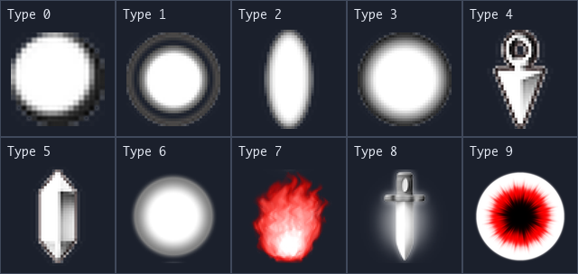

| 外形类别 | Type | 描述 | 有效颜色 | 图集 | ANM | 首帧精灵范围 |
|---|---:|---|---:|---|---:|---|
| 粒弹 | 0 | 小型实心圆点 | 16 | `etama3` | 0 | 14–29 |
| 环形小玉 | 1 | 实心中心带明显外圈 | 16 | `etama3` | 1 | 30–45 |
| 米弹 | 2 | 细长椭圆、米粒形 | 16 | `etama3` | 2 | 46–61 |
| 实心小玉 | 3 | 圆形中心、柔边光晕 | 16 | `etama3` | 3 | 62–77 |
| 苦无弹 | 4 | 带尾环的三角箭头 | 16 | `etama3` | 4 | 78–93 |
| 针形弹 | 5 | 细长棱晶形 | 16 | `etama3` | 5 | 94–109 |
| 大玉 | 6 | 大型实心圆弹 | 8 | `etama3` | 6 | 110–117 |
| 火球 | 7 | 火焰形、循环换帧 | 1 | `etama3` | 7 | 118；后续帧 119–121 |
| 刀弹 | 8 | 短刀形 | 8 | `etama3` | 8 | 122–129 |
| 大泡 | 9 | 大型空心光环 | 5 | `etama4` | 0 | 0–4 |

运行时通过 `battle::EnemyBullet(type, color)` 选择素材：`type` 为 0–9，输入 `color` 为 0–15。Type 0–5 原样使用 16 色；Type 6/8 使用 `color % 8`；Type 7 固定一种颜色；Type 9 使用 `color % 5`。Type 9 实际使用 `etama4` 的脚本 0，不使用 `etama3` 的同号脚本 9。

### 1.1 粒弹（Type 0，16 色）

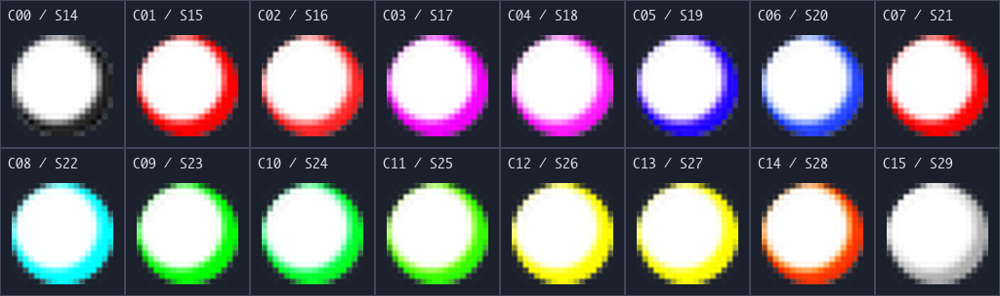

### 1.2 环形小玉（Type 1，16 色）

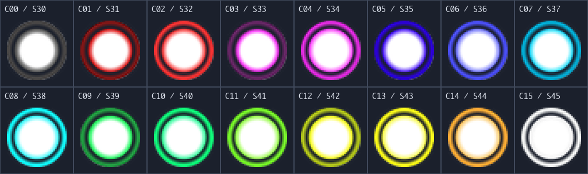

### 1.3 米弹（Type 2，16 色）

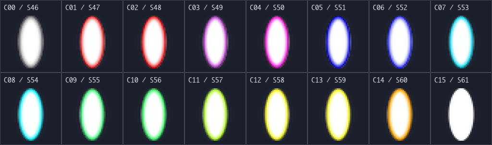

### 1.4 实心小玉（Type 3，16 色）

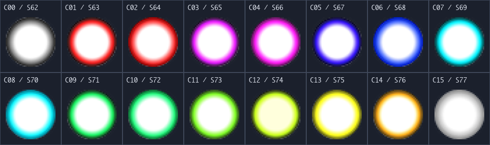

### 1.5 苦无弹（Type 4，16 色）

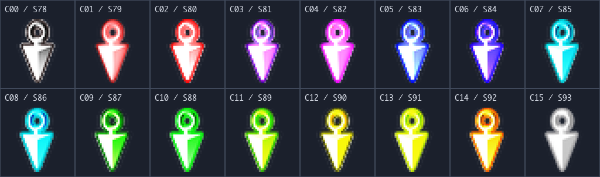

### 1.6 针形弹（Type 5，16 色）

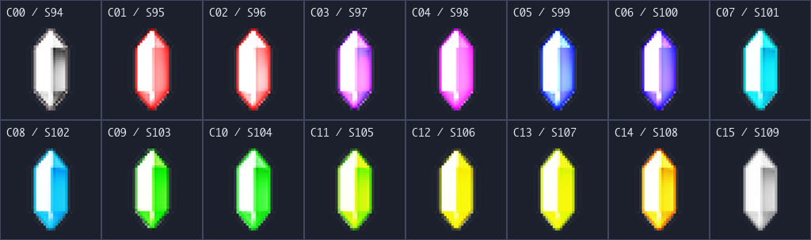

### 1.7 大玉（Type 6，8 色）

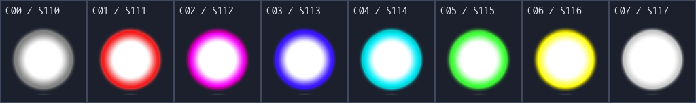

### 1.8 火球（Type 7，1 色、4 张动画精灵）

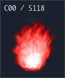

下图是同一弹种的四张动画素材，不是四种颜色。脚本在内容帧 0、5、10、15 选择精灵 118、119、120、121。

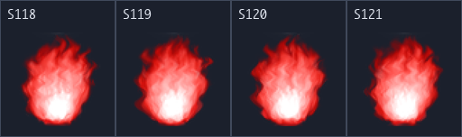

### 1.9 刀弹（Type 8，8 色）

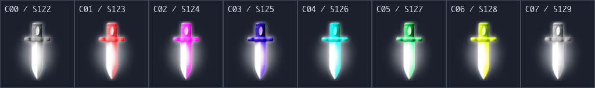

### 1.10 大泡（Type 9，5 色）

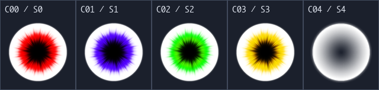

## 2. 敌方激光

敌方激光使用独立图集 `etama3_2`，有 **2 套纹理脚本，每套 16 个颜色索引**。以下列出全部 32 个脚本/颜色选择；它们不计入普通敌弹的 10 类、118 个组合。

| 纹理套组 | ANM | 精灵范围 | 选择方式 |
|---|---:|---|---|
| 默认套组 | 0 | 0–15 | `kNativeLaserBase + color` 默认绑定 |
| 第二套组 | 1 | 16–31 | 原始图集包含这套素材；当前 `dev/koumakyou` 尚未接入运行时选择 |

### 2.1 默认套组（ANM 0）

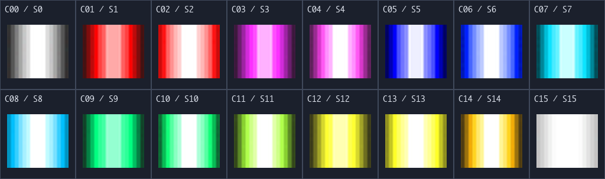

### 2.2 第二套组（ANM 1）

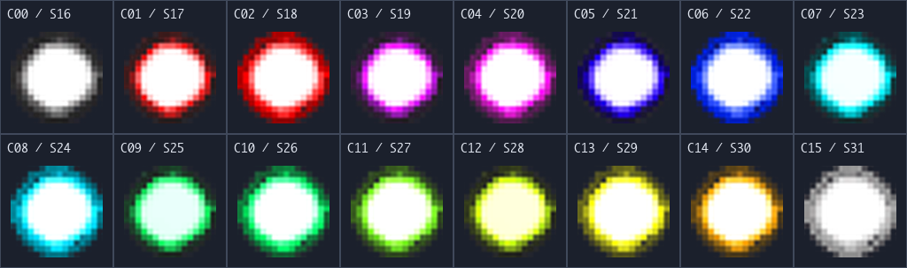

预警、展开、持续、收束，以及伸长、移动、旋转等由光束参数和行为控制，不另算纹理弹种。激光的碰撞使用线段胶囊，普通弹使用球形判定；纹理裁图的宽高不能直接当作判定尺寸。当前运行时的光束尺寸、时序与碰撞字段见 [types.hpp](../src/gameplay/bullets/types.hpp)。

## 3. 灵梦自机弹体

使用 `player00.dds` / `player00.anm`，共三个素材绑定。

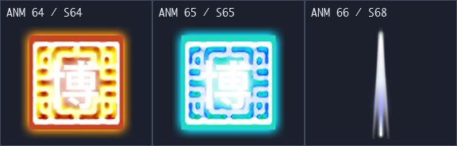

| 弹体 | 外观常量 | ANM | 精灵 | 用途 |
|---|---|---:|---:|---|
| 金色直射符札 | `kPlayerGoldCard` | 64 | 64 | 中央直射主弹 |
| 青色追踪符札 | `kPlayerCyanCard` | 65 | 65 | 追踪副弹 |
| 梦之御札侧针 | `kPlayerNeedle` | 66 | 68 | 双侧针弹，不追踪 |

实机射击额外乘以 `Player::kShotAlpha`（Alpha 51），再与 ANM 透明度及贴图 Alpha 相乘；本页为了辨识素材不叠加该衰减。详细射击表见 [灵梦追踪弹对照](REIMU_HOMING_REFERENCE.md) 和 [梦之御札侧针对照](REIMU_NEEDLE_REFERENCE.md)。

## 4. 魔理沙自机弹体

使用 `player01.dds` / `player01.anm`，共 **12 个素材绑定**：主弹 1、导弹 4、激光 3、命中爆破 4。同一精灵在不同档位复用，通过脚本缩放、颜色、透明度和时序等区分，不能把每个档位当成一张独立原图。

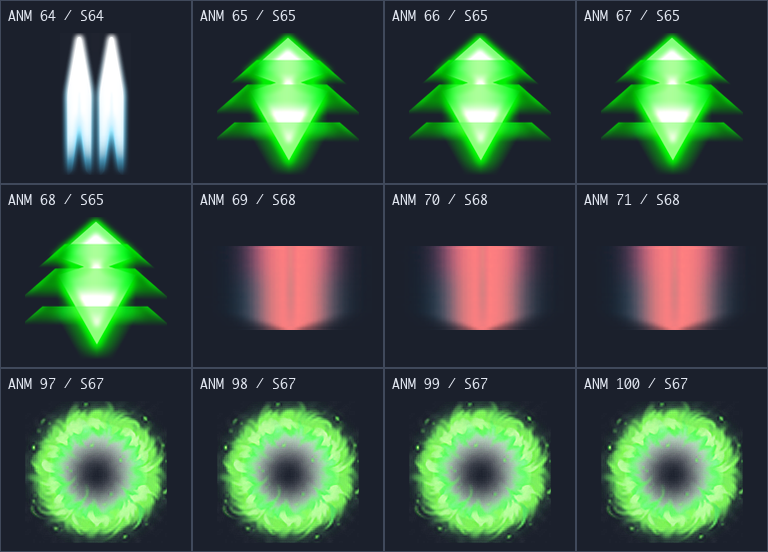

| 弹体/档位 | 外观常量 | ANM | 精灵 | 用途 |
|---|---|---:|---:|---|
| 中央主弹 | `kMarisaPrimary` | 64 | 64 | 两种御札的直射主弹 |
| 导弹 1 | `kMarisaMissile + 0` | 65 | 65 | 魔之御札副弹 |
| 导弹 2 | `kMarisaMissile + 1` | 66 | 65 | 魔之御札副弹 |
| 导弹 3 | `kMarisaMissile + 2` | 67 | 65 | 魔之御札副弹 |
| 导弹 4 | `kMarisaMissile + 3` | 68 | 65 | 魔之御札副弹 |
| 激光 1 | `kMarisaLaser + 0` | 69 | 68 | 恋之御札持续光束 |
| 激光 2 | `kMarisaLaser + 1` | 70 | 68 | 恋之御札持续光束 |
| 激光 3 | `kMarisaLaser + 2` | 71 | 68 | 恋之御札持续光束 |
| 爆破 1 | `kMarisaExplosion + 0` | 97 | 67 | 对应导弹命中后的持续爆破 |
| 爆破 2 | `kMarisaExplosion + 1` | 98 | 67 | 对应导弹命中后的持续爆破 |
| 爆破 3 | `kMarisaExplosion + 2` | 99 | 67 | 对应导弹命中后的持续爆破 |
| 爆破 4 | `kMarisaExplosion + 3` | 100 | 67 | 对应导弹命中后的持续爆破 |

普通弹命中消失，导弹命中切换爆破，激光与爆破按有效时间持续伤害；对应 `PlayerShotKind::Projectile / Missile / Laser / Explosion`。档位预览均适配同样大小的格子，实际档位尺寸和火力表见 [魔理沙御札对照](MARISA_SHOTS_REFERENCE.md)。

## 5. Bomb 攻击实体与素材层

四种 Bomb 使用独立实体系统，不占普通弹幕池。下图逐层展示其素材及脚本染色；球体、六面法阵、星群和圆台光束的三维形状由运行时网格和攻击体积构成，不是额外的 DDS 图。详细时序与三维适配见 [四 Bomb 对照](PLAYER_BOMBS_REFERENCE.md)。

| 角色/御札 | Bomb | 图集 | ANM | 精灵 | 当前三维表现 |
|---|---|---|---|---:|---|
| 灵梦·灵之御札 | 灵符「梦想封印」 | `player00` | 133–136 | 131 | 七颗追踪光球，每颗组合四色素材层，命中累计或到时爆破 |
| 灵梦·梦之御札 | 梦符「封魔阵」 | `player00` | 137–140 | 132 | 从施放点向六面边界扩展的法阵 |
| 魔理沙·魔之御札 | 魔符「Stardust Reverie」 | `player01` | 5–7 | 18 | 64 颗三色素材星群及较小拖影 |
| 魔理沙·恋之御札 | 恋符「Master Spark」 | `player01` | 8–11 | 19 | 一根同轴叠加四色材质的宽束光炮 |

### 5.1 梦想封印：四个素材层

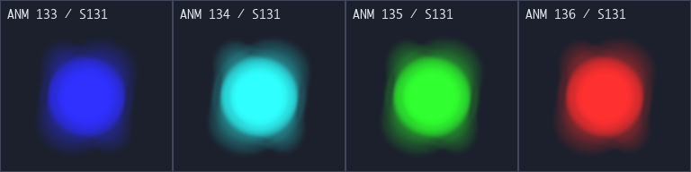

### 5.2 封魔阵：四个素材层

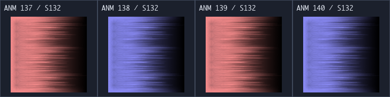

### 5.3 Stardust Reverie：三个素材层

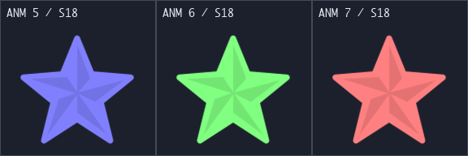

### 5.4 Master Spark：四个素材层

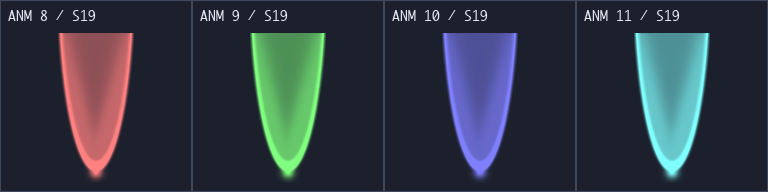

## 6. 与弹体配套的非攻击素材

本节便于找图，不计入弹体数量。副机本身没有弹体碰撞；显现和击破素材是动画效果，不能作为新的攻击种类。

### 6.1 灵梦太极圈与魔理沙星形副机

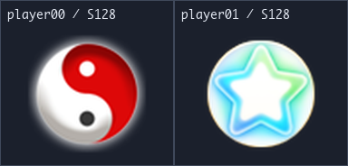

| 物件 | 图集 | 左/右 ANM | 精灵 | 外观常量 |
|---|---|---|---:|---|
| 灵梦太极圈 | `player00` | 128 / 129 | 128 | `kPlayerOptionLeft / kPlayerOptionRight` |
| 魔理沙星形副机 | `player01` | 128 / 129 | 128 | `kMarisaOptionLeft / kMarisaOptionRight` |

同一角色两侧复用一张原图，独占动画游标；灵梦两侧反向旋转，魔理沙两侧同向旋转。

### 6.2 敌弹显现光圈

下图列出显现素材的五个色差，行标题 `small / normal / bubble` 分别表示粒弹、其他普通弹和大泡所用的素材组。只展示原裁图，未应用显现脚本的缩放与透明度。

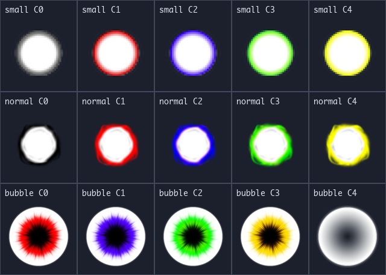

| 对象 | 图集 | ANM | 精灵 | 说明 |
|---|---|---|---|---|
| Type 0 | `etama3` | 14 / 15 / 16 | 135–139 或 140–144 | 分别对应 10 / 16 / 32 内容帧显现 |
| Type 1–5 | `etama3` | 17 / 18 / 19 | 140–144 | 分别对应 10 / 16 / 32 内容帧显现 |
| Type 6–8 | `etama3` | 20 | 140–144 | 大弹显现；火球使用固定显现色 |
| Type 9 | `etama4` | 2 | 0–4 | 大泡显现，复用大泡本体素材 |

`battle::BulletSpawn(type, color, frames)` 接收 10、16、32 帧参数；大弹和大泡选择自己的专用脚本。五种显现色由原映射表选择，不直接把敌弹的 16 色索引当作五色索引。

### 6.3 公共击破效果

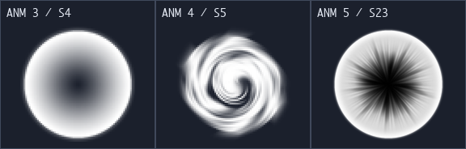

`etama4` 脚本 3、4、5 分别绑定 `kNativeDefeat + 0/1/2`；对应首张精灵 4、5、23。图中是演员击破动画的素材，不是额外敌弹或导弹爆破。

## 7. 原始图集与预览

下列总览最长边缩至 1024 像素；精确像素和动画指令请打开原始 DDS/ANM。裁切时按 ANM 逻辑尺寸换算 UV，不假定每张 DDS 都相对 ANM 放大相同比例。

| 图集 | DDS 像素尺寸 | ANM 逻辑尺寸 | 原始文件 |
|---|---|---|---|
| `etama3` | 2048 × 2048 | 1024 × 1024 | [DDS](../assets/runtime/battle/native/etama3.dds) / [ANM](../assets/runtime/battle/native/etama3.anm) |
| `etama3_2` | 256 × 256 | 256 × 256 | [DDS](../assets/runtime/battle/native/etama3_2.dds) / [ANM](../assets/runtime/battle/native/etama3_2.anm) |
| `etama4` | 1024 × 1024 | 512 × 512 | [DDS](../assets/runtime/battle/native/etama4.dds) / [ANM](../assets/runtime/battle/native/etama4.anm) |
| `player00` | 2048 × 2048 | 1024 × 1024 | [DDS](../assets/runtime/battle/native/player00.dds) / [ANM](../assets/runtime/battle/native/player00.anm) |
| `player01` | 2048 × 2048 | 1024 × 1024 | [DDS](../assets/runtime/battle/native/player01.dds) / [ANM](../assets/runtime/battle/native/player01.anm) |

### 7.1 etama3：普通敌弹、显现与道具

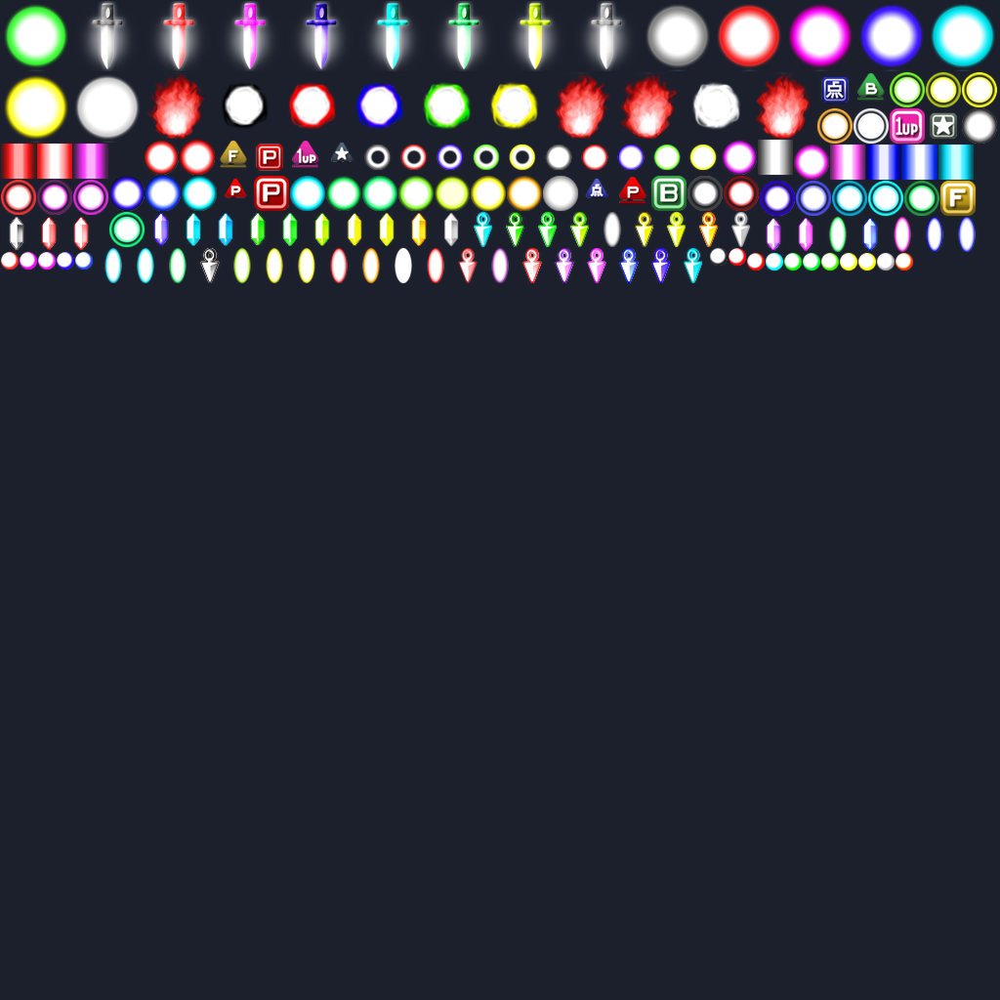

### 7.2 etama3_2：两套敌方激光

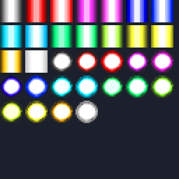

### 7.3 etama4：大泡与效果

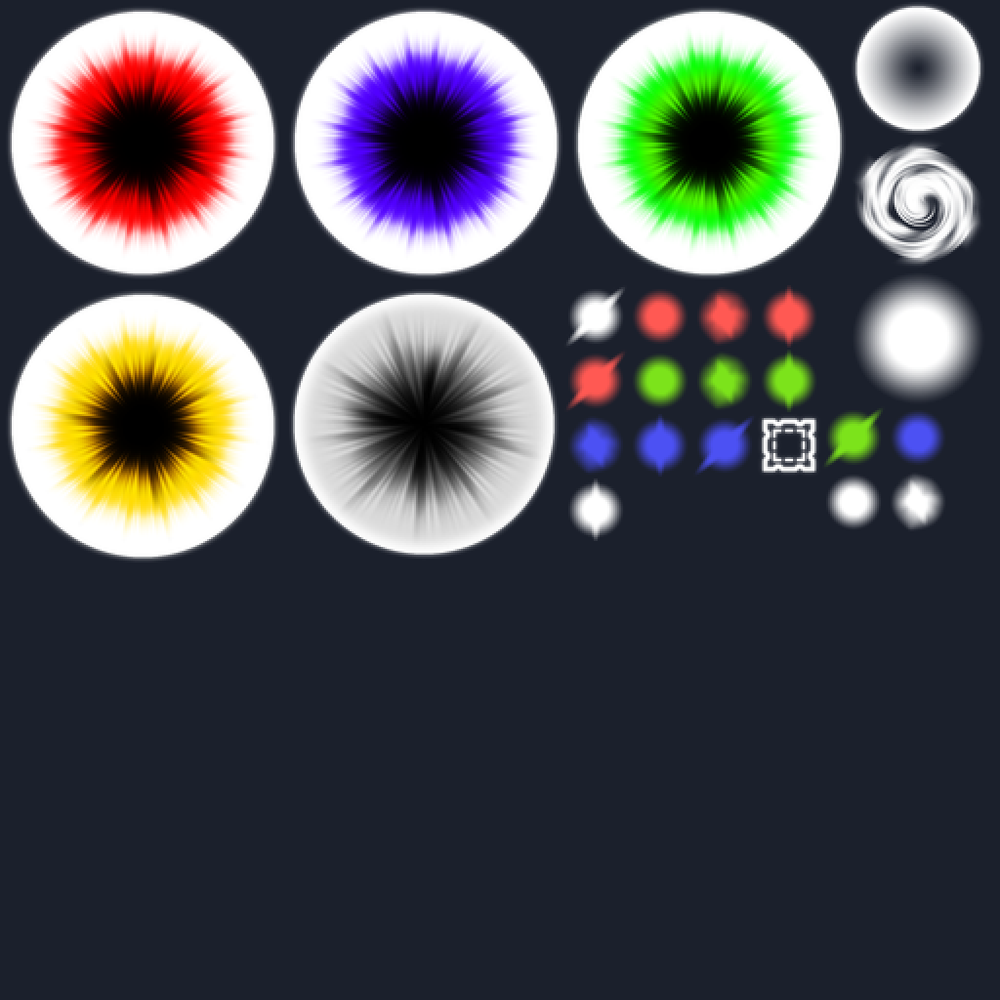

### 7.4 player00：灵梦射击、副机与 Bomb

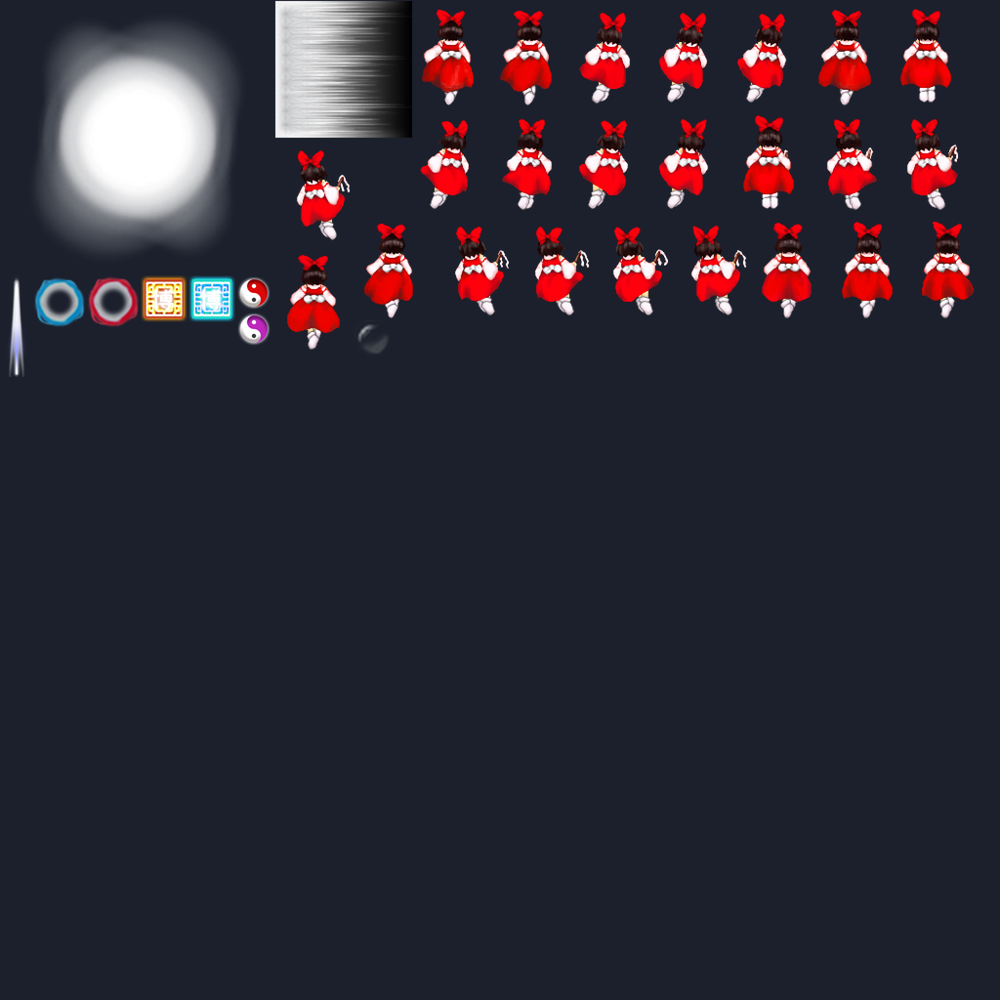

### 7.5 player01：魔理沙射击、副机与 Bomb

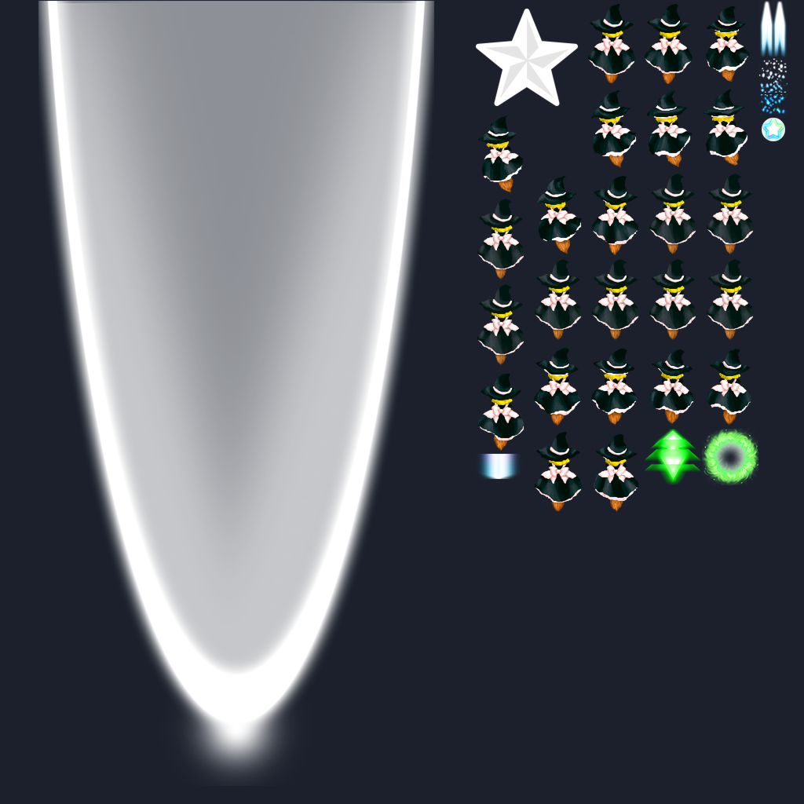

图集中还包含自机身体、道具或其他动画；本目录没有将这些内容计为弹体。全部战斗图集的加载和生命周期约定见 [原始战斗素材接口](NATIVE_BATTLE_ASSETS.md)。

## 8. 仓库保留的旧版弹体 PNG

仓库还有两款旧版弹体各自的源图和运行时 PNG，共四个文件。当前战斗素材清单不再引用它们；保留在这里供历史素材查找，不计入当前敌弹的有效颜色数量。

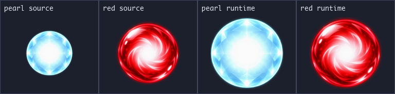

| 素材 | 源图 | 运行时图 |
|---|---|---|
| 白珠弹 | [bullet_pearl.png](../assets/source/bullet_pearl.png)，1254 × 1254 | [bullet_pearl_runtime.png](../assets/runtime/stages/stage1/bullet_pearl_runtime.png)，512 × 512 |
| 红弹 | [bullet_red.png](../assets/source/bullet_red.png)，1254 × 1254 | [bullet_red_runtime.png](../assets/runtime/stages/stage1/bullet_red_runtime.png)，512 × 512 |

`kBlueBullet`、`kRedBullet`、`kGreenSphere` 目前均绑定 Type 3 的不同颜色，不对应三套独立弹体原图。
