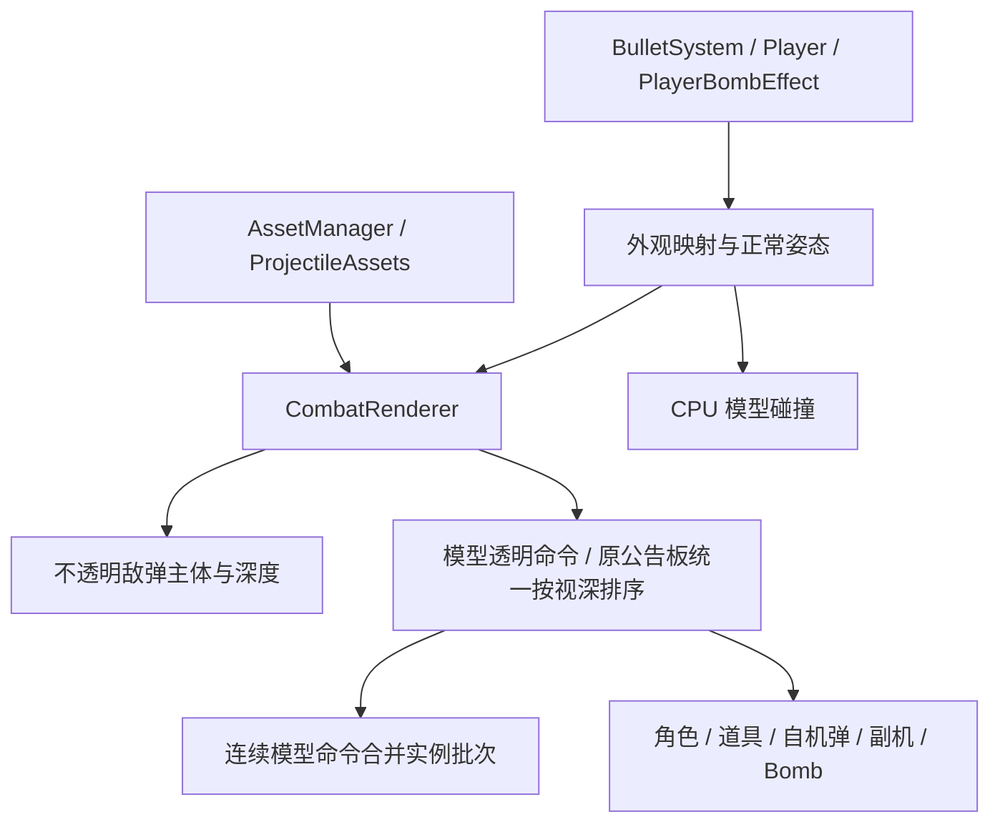

# 三维弹体运行时接入

当前已接入十类敌弹、两套参数激光、自机弹与各档位、两款副机、梦想封印/星群/Master Spark 以及公用 spawn。封魔阵和公共击破保持原实现；不制作额外三维 defeat。原模型外观已验收，本轮游戏内组合效果需另行人工审核。

## 模块与资源

```text
src/core/projectile_pose.hpp                   纯 CPU 姿态与参考轴换算
src/resources/projectile_catalog.hpp           独立于 VisualId 的稳定 ProjectileAssetId
src/resources/projectile_binding.hpp            原生弹种/档位映射与正常模型缩放
src/resources/projectile_assets.*               共享模型、纹理、shader、CPU 碰撞与实例缓存
src/gameplay/collision/collision.*              闭合部件/BVH 几何
src/gameplay/collision/projectile_collision.hpp  命中和擦弹查询
src/render/combat_renderer.*                    当帧快照与统一队列调度
src/render/projectiles/                         实例批次、激光、副机、Bomb、spawn 与材质辅助
assets/projectiles/                            现有正式模型和作者源文件
assets/runtime/shaders/projectiles/             唯一正式着色器目录
```

AssetManager 持有关卡级 ProjectileAssets；实例只借用资源，不按弹体重复加载或释放模型。普通弹与激光各使用持久实例缓冲，容量来自弹池上限 8192，不按颜色复制网格。Stage 的 VisualId 只负责已有外观清单；ProjectileAssetId 是跨关卡模型编号，禁止互相转换或重排已有编号。

异步加载每步上传一张原图集纹理或加载一款模型，共享材质与批次单独推进，全部计入进度。未完成时 Projectiles() 返回空；完成后才进入战斗。中途取消或失败会释放已完成部分，重试重新创建缓存。已登记模型缺包、glTF/缓冲/纹理损坏会报加载失败，不能用 raylib 的占位立方体冒充成功。未知手工外观仍走旧绘制和碰撞路径。

CMake 将 glTF/bin、独立 PNG 和 asset.json 复制到可执行文件旁 assets/projectiles，着色器随 assets/runtime 一起复制；不分发 .blend、工具、缓存和审阅输出。运行时代码不引用 tools；工具头文件/实现是正式模块的兼容转发，材质也使用正式目录。

## 姿态、尺寸与碰撞

Bullet::SetVelocity 同步方向与连续 Orientation，静止保留；固定激光使用同一单位方向。模型本地正向通过目录描述适配到该正常姿态，显示与碰撞共享位置、旋转和正常缩放。模型正向的连续更新不随相机改变。

敌弹按原参考危险半径与模型碰撞包围半径换算缩放；自机弹按原外观高度和 glTF 正向跨度换算，导弹应用对应静态档位。新实体危险体积会区别于旧球形判定，需要游戏内验收。近接触先做包围体排除，再查询闭合网格/BVH；尾环孔洞保留，泡弹危险体积为白光圈内部，外层光效不加入碰撞。碰撞查询只读 CPU 数据，并复用预分配工作区。

普通弹命中、擦弹与 Debug 几何共用模型危险体积；无模型时沿用旧球/胶囊。光束的起点、方向、长度和半径继续来自 Bullet，预警、生效和退场时窗不改变。Bomb 的伤害、通道并集和清弹继续由 BombVolume 计算，不能拿装饰模型重复计伤害。

## 绘制与显现



不透明敌弹主体先写深度；透明模型命令按实际深度进入原队列，只合并演员和道具之间连续的模型命令。能量层加色，半透明主体用 Alpha 混合，均关闭深度写入。长光束沿原队列切片裁剪完整模型，不重复端帽或重启螺旋相位。

spawn 直接变换目标模型本身：从大缩至正常大小，同时透明度由高到低，结束后保持正常状态。每弹读取自身 age/spawnVisualSeconds；正常碰撞不随放大变化，显现期间仍按原 Dangerous() 规则无害。暂停时动画、朝向与材质时钟冻结。

副机复用左右独立 ANM 旋转与透明度、现有位置和 Focus 尺寸，球体采用独立纹理并共享柔光纹理。三款 Bomb 采用已验收模型；星群不画已取消的小星拖影，模型尺寸独立于攻击体积。Master Spark 的显示炮口在视点前下方、使用模型默认近远截面参数，原圆台攻击覆盖不变；四层原生光炮合并为一次混色模型绘制并补偿亮度。近眼球体/星群降低曝光，不改变攻击。

## 运行与检查

双击 Run-Model-Game.cmd，或用 tools/run_model_game.ps1 -BuildOnly 仅构建。首次缺工具时先运行 Setup-Projectile-Tools.cmd。所有工具、依赖和临时环境保持项目内隔离。

- 核心游戏和方向测试：构建 koumakyou_tests、projectile_direction_tests 后执行对应 CTest。
- 模型集成：构建 projectile_runtime_tests，参数为素材根目录和可选截图目录，检查 24 款资源、方向、真实孔洞、批次渲染、损坏文件拒绝、逐步加载取消/重试和重复卸载。
- 实际游戏：koumakyou_lifecycle_tests 的 --player-shots-only、--marisa-only、--bomb-only，以及 koumakyou_loading_tests；默认不执行历史计时段。
- 独立工具：Review-Projectiles/Lasers/Reimu/Marisa/Bombs/Options/Effects.cmd 均继续可用，run.ps1 -Action test 执行几何与渲染正确性检查。

本轮截图位于 output/projectile-review/runtime：enemy-models-runtime.png、player-shots-*.png、marisa-*.png、bomb-bomb-*-1100.png。没有新增模型性能压测；历史计时段只有显式设置 KOUMAKYOU_RUN_PERF_TESTS=1 才启用。
