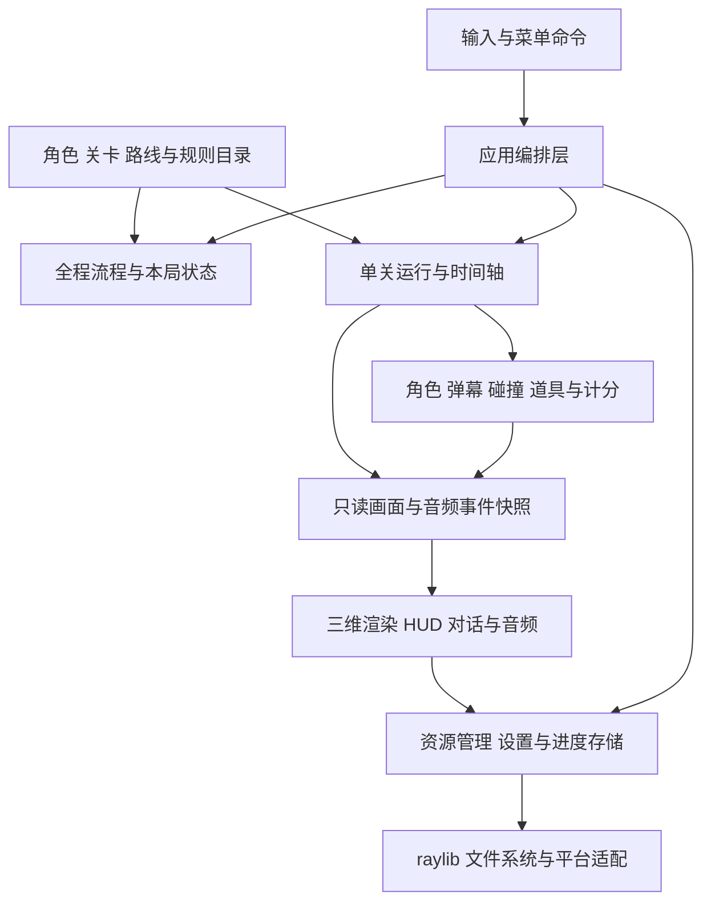
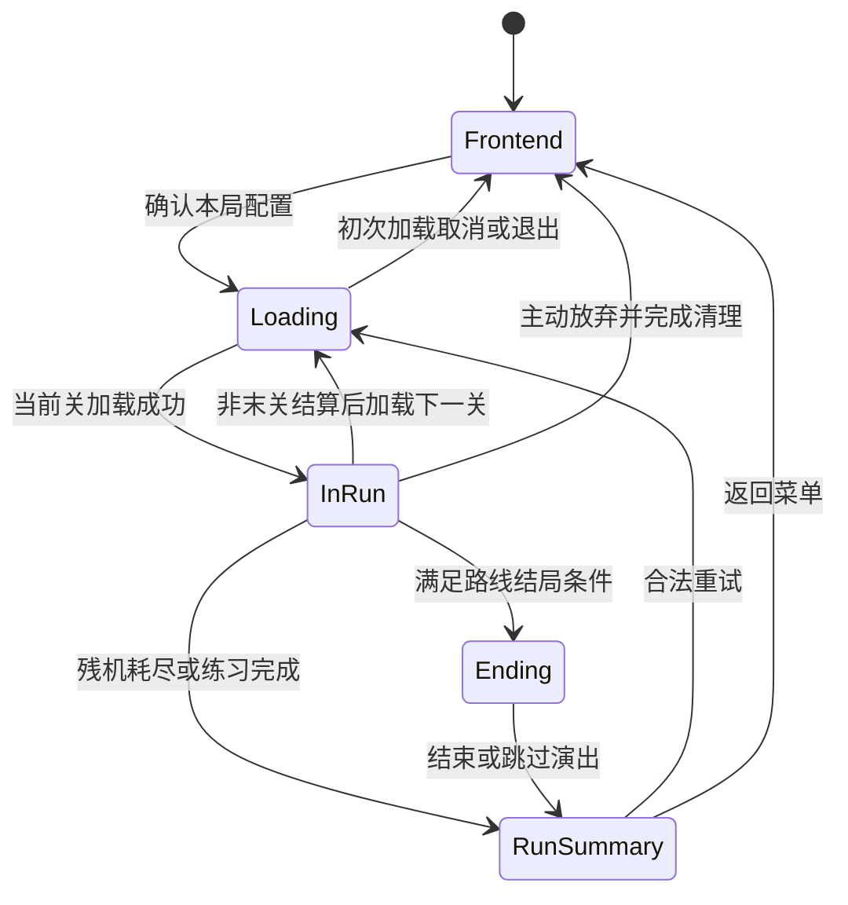
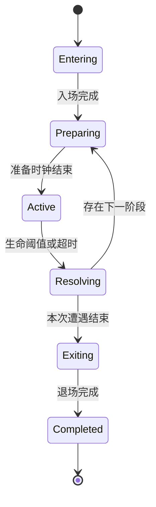
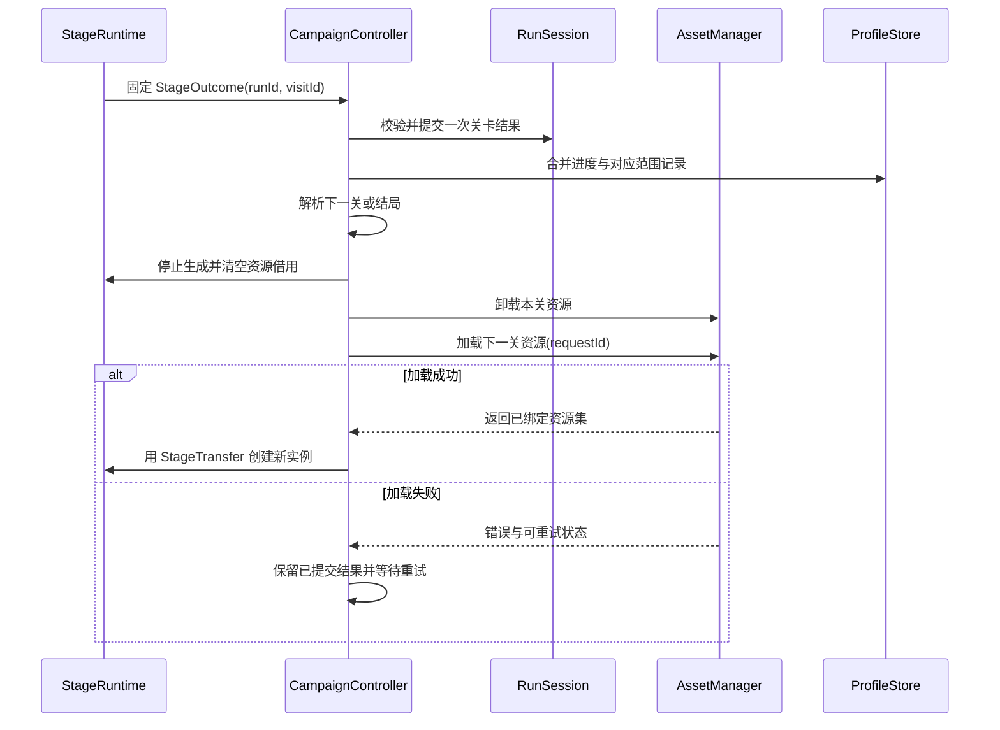

# koumakyou 软件设计说明书

设计日期：2026 年 10 月 19 日。

需求依据：[NABCD 需求分析](NABCD.md)。本文面向最终产品——**将《东方红魔乡：新典》的全流程关卡改造为可连续通关的第一人称三维弹幕游戏**，给出概要设计与关键详细设计，作为实现、内容制作和验收的共同依据。

本文中的模块、接口和数据结构是目标设计；现有第一面实现提供技术基础，不代表所有设计均已完成。现有代码结构和实现细节仍见[当前实现设计说明](DESIGN.md)。本文不改变原作关卡归属与分支关系；具体台词、符卡参数、结局条件及原作解锁条件通过内容清单核对后录入。

## 1. 设计目标与系统边界

### 1.1 产品目标

系统应支持玩家选择角色、机体、难度和模式，从主线起点连续推进全部主线关卡，经历道中、Boss、对话、关卡结算和最终结局。原作独立追加关卡作为独立路线运行，遵循目录中配置的进入条件，不在主线末尾自动串接。

三维改造保留原作的关卡主题、剧情脉络、攻击辨识度与音乐节奏，并围绕第一人称观察、三轴移动和空间信息重新设计弹幕展开、提示与难度平衡。整关、Boss 和符卡练习为完整通关提供训练入口。

### 1.2 系统边界与设计选择

| 项目 | 设计决定 |
| --- | --- |
| 运行形态 | Windows/macOS 本地桌面单人游戏，离线完成主流程 |
| 技术基础 | C++20、raylib、CMake；游戏逻辑与窗口、音频、文件系统通过适配层隔离 |
| 内容边界 | 原作完整主线、独立追加路线、角色与机体、难度、对话、符卡和结局；以版本化内容目录登记 |
| 基础交互 | 第一人称鼠标观察，三轴移动，射击、低速移动、Bomb、暂停与菜单操作 |
| 持久化范围 | 设置、解锁、通关和练习记录；基础版本不保存任意战斗时刻，也不将退出视为通关 |
| 记录体系 | 正式全程、无限残机挑战和各类练习分别记录；调试与预览不写入有效成绩 |
| 扩展边界 | 网络对战、云同步、在线排行榜和完整回放系统不作为本设计的交付依赖 |

不在本说明书中预先固定全部弹速、生命和奖励数值。它们属于有版本的内容配置，需要经过原作核对与三维试玩平衡；影响判定、继承和成绩分类的规则则在本文明确。

### 1.3 需求到设计的对应

为便于验收，将 NABCD 中的产品诉求整理为以下设计需求编号。

| 编号 | 设计需求 | 主要承担模块 |
| --- | --- | --- |
| R01 | 全主线连续推进，独立追加路线和结局正确分流 | CampaignCatalog、CampaignController、EndingController |
| R02 | 第一人称三轴移动、瞄准与一致的碰撞判定 | InputRouter、PlayerController、CombatSystem |
| R03 | 各关敌人与符卡保留特色并形成有效空间策略 | StageContent、BossController、PatternRuntime |
| R04 | 多角色、机体和难度贯穿全程 | CharacterCatalog、RunConfig、RuleSet |
| R05 | 正式通关与无限残机挑战具有不同失败和记录规则 | RunSession、RuleSet、ScoreService |
| R06 | 整关、Boss、符卡练习可直接进入并重复挑战 | PracticeController、PracticePreset |
| R07 | 关卡场景、对话、音乐与演出共同形成完整旅程 | SceneRenderer、DialogueController、AudioDirector |
| R08 | 玩家能够理解危险方向、距离和失败原因 | ThreatSystem、HUD、操作引导 |
| R09 | 设置、进度、成绩持久化且分类明确 | SettingsStore、ProfileStore、RecordKey |
| R10 | 高弹量运行与跨关资源切换稳定 | SimulationLoop、对象池、AssetManager |
| R11 | 新关卡沿统一规范制作、校验和测试 | 内容构建工具、ContentValidator、自动化测试 |
| R12 | Windows/macOS 可直接启动并完成全流程 | PlatformAdapter、打包工具、发布验收 |

## 2. 用户用例与交互入口

主要参与者为玩家；内容制作者负责录入和调试关卡，测试人员负责验证规则、流程和交付。运行时不要求用户登录外部服务。

| 用例 | 前置条件与入口 | 主要流程 | 结束结果 |
| --- | --- | --- | --- |
| 正式全程游戏 | 主菜单，存在有效主线路线 | 选择难度、角色、机体、模式，确认后连续推进 | 失败、主动退出或进入结局及全程结算 |
| 独立追加路线 | 满足内容目录定义的进入条件 | 选择允许的配置，加载该路线独立入口 | 独立结算，不并入本次主线分数 |
| 练习 | 存在已开放的练习条目 | 选择关卡/Boss/符卡及配置，应用固定预设后开始 | 写入对应练习记录，重试或返回选择页 |
| 调整设置 | 菜单或允许的暂停设置页 | 调整键位、灵敏度、音量和显示项，立即反馈 | 保存设置，不改变本局计分规则 |
| 暂停与继续 | 战斗、对话、演出或结算等待中 | 冻结游戏时钟，释放鼠标，选择继续或离开 | 精确返回原阶段，或统一清理后退出 |
| 查看记录 | 主菜单成绩与进度页 | 按路线、难度、角色、机体和模式筛选 | 显示有效通关、最高分及练习表现 |

菜单按“难度 → 角色 → 机体 → 模式 → 最终确认”组织；练习在确认前增加目标选择。未开放条目显示条件并禁止启动，返回上一级保留选择。操作引导使用独立教学入口或首次进入时的可跳过引导，不修改正式关卡的隐含规则。

## 3. 总体架构

### 3.1 分层与依赖

采用分层的本地游戏架构。应用层编排用例，领域层维护游戏规则，内容层提供经过校验的定义，表现层消费只读快照，基础设施层实现资源、存储和平台能力。



箭头表示调用或数据流。领域对象不通过渲染器修改状态；表现层不能决定受击、加分、解锁或切关。目录不能依赖正在运行的游戏实例。初期保留 `Game` 作为门面，将全程控制、单关状态和战斗规则逐步移出，避免总控继续承担全部职责。

### 3.2 核心模块职责

| 模块 | 职责 | 输入与输出 | 不承担的职责 |
| --- | --- | --- | --- |
| Game/Application | 窗口生命周期、顶层状态、输入路由、每帧调度 | 平台输入 → 应用命令与呈现 | 不保存各关专属判断 |
| CampaignController | 路线选择、跨关继承、结局分支、整轮结束 | RunConfig、StageOutcome → 下一流程指令 | 不直接创建单颗敌弹 |
| RunSession | 持有一轮游戏身份、不可变配置和累计状态 | 合法领域事件 → 更新后的本局状态 | 不拥有 GPU 资源 |
| StageRuntime | 持有当前关卡实例、时间轴、对话与局部结果 | StageContext → StageOutcome | 不自行选择下一关 |
| StageContent/ContentCatalog | 提供只读关卡、角色、Boss、路线与素材定义 | 稳定 ID → 已校验定义 | 不持有本局可变血量等状态 |
| PlayerController | 移动、视角、射击、Bomb 请求、复活姿态 | TickInput、规则 → 玩家状态与攻击请求 | 不直接写档 |
| BossController/PatternRuntime | Boss 阶段、攻击脚本、空间图案和超时 | 固定步长、目标快照 → 生成命令与阶段结果 | 不直接调用 UI 页面 |
| CombatSystem | 命中、擦弹、Bomb、击破、拾取和奖励裁决 | 运动轨迹、碰撞体 → 有序领域事件 | 不播放声音或绘制贴图 |
| ThreatSystem | 按实际危险几何生成空间提示 | 玩家、危险对象 → 方向与紧迫程度 | 不修改弹幕速度或伤害 |
| Render/Dialogue/Audio | 展现场景、HUD、文字、演出与音频 | 快照、事件与资源借用句柄 → 画面和声音 | 不推进战斗时间轴 |
| AssetManager | 清单加载、共享资源缓存、主线程上传和释放 | LoadRequest → 资源集或加载错误 | 不决定成绩和关卡分支 |
| SettingsStore/ProfileStore | 设置、进度、记录的校验、迁移和可靠写入 | 值对象 → 保存结果与可重试错误 | 不序列化活动纹理或对象指针 |

### 3.3 目标目录组织

以下为目标组织，可在迁移中分步形成。

```text
src/
  app/                 # 应用状态、输入路由与主循环
  campaign/            # 全程控制、本局配置、资源继承与结局分支
  stage/               # 单关运行、时间轴、目录和内容接口
  stages/stage1..6/    # 各主线关卡的定制行为与绑定
  stages/extra/        # 独立追加路线的定制行为与绑定
  characters/          # 角色、机体、射击与 Bomb 策略
  gameplay/            # 角色、弹幕、战斗、掉落、效果与威胁提示
  render/              # 世界、精灵、透明排序、HUD 与界面布局
  narrative/           # 对话、演出和结局播放
  resources/           # 素材清单、解析、加载、缓存与音频
  persistence/         # 设置、用户进度、记录与数据迁移
  platform/            # 窗口、输入、路径等平台适配
assets/
  runtime/common/      # 通用界面、字体与共用资源
  runtime/characters/  # 角色资源清单
  runtime/stages/      # 按关卡组织的运行素材
  runtime/campaigns/   # 路线、结局和解锁配置
  source/              # 制作与参考材料，不进入运行包
```

目录中的主线编号用于组织内容；流程始终通过目录查询，不能写成 `stageIndex + 1` 后直接加载。独立追加路线使用单独的标识与路由。

## 4. 领域对象与数据约定

### 4.1 身份、单位与所有权

- `CampaignId`、`StageId`、`CharacterId`、`ShotId`、`SpellId`、`RuleSetId` 和 `EndingId` 使用稳定内容键，保存后不随数组排序变化。显示编号只用于 UI。
- `SpellId` 在内容目录中唯一；事件 ID 只在单张关卡事件表内唯一；活动对象句柄由“槽位编号＋代数”构成，防止对象池复用后误指向新对象。
- 所有位置和长度使用世界单位，速度使用世界单位/秒，加速度使用世界单位/秒²，角度使用弧度。X 为横向，Y 为高度，Z 为纵深；初始前方为 +Z。
- 战斗时间使用从本关开局或阶段开局起算的整数 tick，基础频率为 60 Hz；UI 使用非负秒数；现实日期仅用于记录展示，不参与判定。
- `RunConfig` 创建本局后不可变；`StageDefinition` 等定义在绑定期间只读。可变状态不得写回共享内容定义。
- `StageRuntime` 独占演员、弹幕、道具和局部效果；资源管理器独占 GPU/音频句柄，其他模块只借用。卸载前必须停止所有资源借用。

### 4.2 静态定义

| 数据结构 | 关键字段 | 约束与作用 |
| --- | --- | --- |
| CampaignDefinition | id、entryStage、nodes、transitionRules、endingRules、unlockRules | 入口存在；普通主线转换不形成无意循环；追加路线单独登记 |
| StageDefinition | id、arena、events、encounters、dialogue、scenery、assets、ruleOverrides | 内容完整，资源存在，覆盖支持的角色/难度组合 |
| CharacterDefinition | id、shotIds、movementProfile、portraitSet、dialogueRoute | 机体必须归属该角色，移动参数为有限合法值 |
| ShotDefinition | id、powerLevels、firePattern、homingRule、bombDefinition | 火力档有序；伤害、冷却、转向等参数有单位和范围 |
| DifficultyProfile | id、patternVariants、speedScale、countScale、rankBounds | 难度与动态 rank 分开表达；只开放有完整内容的组合 |
| BossEncounterDefinition | id、entry、phases、exit、completionPolicy | 阶段 ID 唯一；每阶段具有击破或超时结束路径 |
| PhaseDefinition | id、kind、hp、durationTicks、protectionTicks、pattern、cleanup、rewards | 准备期不受伤；符卡 ID、血条组和奖励规则明确 |
| DialogueDefinition | id、lines、speakerIds、expressions、musicCues | 支持多说话人和角色路线，不假定只存在玩家与单一 Boss |
| RuleSet | id、version、lifeRule、bombRule、scoreRule、carryRule、eligibility | 判定、奖励、继承及成绩分类的共同依据 |
| PracticePreset | target、playerResources、power、rank、seedPolicy、unlockPolicy | 指定起点和准备阶段，避免直接跳到无初始化的攻击循环 |

内容配置使用带 `schema_version` 的 UTF-8 JSON；定制行为保留在 C++ 模块，通过白名单行为 ID 引用。启动或进入路线时把配置解析为有类型的只读对象，战斗热循环不解析 JSON，也不执行任意配置代码。原作导入数据保留来源标识和转换版本，三维适配参数独立记录，便于核对差异。

### 4.3 运行数据

| 数据结构 | 字段与职责 |
| --- | --- |
| RunConfig | 路线、角色、机体、难度、模式、规则版本、起始资源配置、练习目标；确认后冻结 |
| RunSession | runId、config、currentStage、累计分数/擦弹/Miss、残机、Bomb、Power、随机流状态、有效成绩标记、已提交关卡结果集合 |
| StageContext | 本次关卡访问 ID、内容版本、入口资源快照、角色能力、规则引用、练习覆盖与随机种子 |
| StageRuntimeState | 本关 tick、阶段、演员和对象池、Boss 状态、局部计数、待处理事件；关卡结束后销毁 |
| PlayerState | 位置、上一步位置、yaw/pitch、碰撞半径、资源、冷却和无敌计时；世界位置为判定中心 |
| ProjectileState | 句柄、归属、前后位置、速度/加速度、轨迹状态、碰撞几何、危险时窗、擦弹标记、生命周期 |
| PhaseResult | 阶段身份、击破/超时/退出原因、Miss/Bomb 使用、奖励；只产生一次 |
| StageOutcome | runId、visitId、stageId、结束原因、资源出口、分数明细、完成标记；提交后只读 |
| StageTransfer | 下一关 ID、待继承资源、已提交结果身份、加载请求身份；只用于跨关，不包含资源句柄 |

单关运行时独占本关分数增量与当前玩家资源；`RunSession` 保存已提交关卡的累计基线和当前关入口资源。HUD 的全程实时值为“已提交基线＋本关增量”，结果提交时只把增量累加一次，并用出口资源替换原资源。失败或主动放弃也生成唯一终局快照以显示本次表现，但不写成通关。这样避免同一笔得分同时在逐 tick 更新和关卡提交中累计两次。

随机流按出生、攻击、掉落分开持有，视觉粒子的随机数不得消耗玩法随机流。保存种子用于定位问题，不据此承诺跨平台逐位一致或完整回放能力。

### 4.4 持久化数据

`SettingsData` 保存音量、灵敏度、键位、显示与上次选择。`PlayerProfile` 保存开放状态、通关记录、各类最高分及内容/规则版本。两者分别写入，恢复默认设置不清除进度。

成绩键统一为：

```text
RecordKey = scope + campaignId + targetId + difficultyId
          + characterId + shotId + mode + ruleSetId + ruleVersion
```

`scope` 区分 Campaign、Stage、BossPractice、SpellPractice；`targetId` 对应相应范围。按关卡保存的正式流程表现与整关练习也必须使用不同模式键。分数使用非负 64 位整数；累加检查溢出并钳制到最大可表示值，不能回绕为负数。

正式成绩资格还取决于 `rankedEligible`：调试无敌、预览、运行中改动战斗参数及非标准起始资源均使本局失去正式资格。自定义资源可游玩并以 Custom 分类保存；挑战模式与标准模式即使分数相同也不共享排行榜。解锁规则明确可接受哪些完成类型，挑战或自定义完成不能自动当作标准正式通关。

## 5. 全流程与状态机设计

### 5.1 状态分层

应用状态管理 Frontend、Loading、InRun、Ending、RunSummary 和退出；`InRun` 内部管理 Combat、Dialogue、Finishing、StageResult、StageTransition。暂停是覆盖在当前状态上的模态层，保留原状态和输入上下文，不另外复制一份战斗世界。



跨关加载失败时保留已提交的 `RunSession` 和 `StageTransfer`，加载页提供重试或返回菜单；它不回到上一关继续运行。结局状态内部先完成资源准备，再进入播放子阶段，加载失败同样可以重试或返回。暂停期间战斗、对话、退场和结算倒计时全部冻结；暂停菜单动画继续，音乐暂停并在恢复时接续。

### 5.2 整轮流程

1. 选择配置，校验角色/机体/难度组合、内容完整性与路线解锁条件。
2. 创建唯一 `runId`、冻结 `RunConfig`，根据路线规则建立入口资源与初始随机状态。
3. 加载入口关卡；资源与内容全部就绪后才初始化战斗并开始计时。
4. 按事件表执行道中、Boss、对话及清场策略；活动对象只由本关持有。
5. 关卡完成后冻结战斗，把关卡奖励加入本关增量一次，随后固定 `StageOutcome`，等待演出收尾及玩家确认。
6. `CampaignController` 根据路线、结果和规则选择下一关或结局，提交本关累计状态与可用进度。
7. 非末关按继承规则建立 `StageTransfer`，卸载本关资源并加载下一关；末关进入配置的结局，之后展示全程总结。
8. 通关成就由路线完成条件判定一次；观看、跳过或重播结局均不再次触发奖励与解锁。

### 5.3 跨关资源继承

| 状态 | 正式全程跨关规则 | 练习或重开规则 |
| --- | --- | --- |
| 角色、机体、难度、模式、规则版本 | 整轮保持不变 | 创建新的练习/重试上下文 |
| 残机、Bomb、Power | 继承关卡结果的出口值；额外补给仅按显式 RuleSet 应用一次 | 从入口预设恢复，不沿用上次练习残余资源 |
| 总分、总擦弹、总 Miss | 累计，关卡奖励只提交一次 | 独立统计，不能混入正式全程 |
| 位置、视角、无敌、射击冷却 | 使用下一关入口规则重建 | 使用同一练习预设重建 |
| 敌人、Boss、弹幕、道具、退场效果 | 清空，不跨关传递 | 清空 |
| 时间轴、对话、Boss 阶段时钟 | 下一关从指定入口重置 | 重置到练习准备阶段 |
| 随机状态 | 按整轮种子、关卡和访问身份派生 | 同种子重试或新种子由练习选项明确决定 |

正式模式失败后的“重新开始”创建一轮新游戏，从路线入口重新开始，不允许隐式用满资源接回失败关卡。练习可直接重试当前目标。返回菜单意味着结束本局，不保存任意中途战斗恢复点。

### 5.4 结局与独立路线

`EndingRule` 按路线、角色/机体、难度和规则认可的完成类型匹配；条件必须互斥，或具有显式优先级及兜底错误提示。内容验证器检查可达终点是否有结局映射。

独立追加路线拥有自己的入口、允许难度、起始资源和完成记录。主线完成可通过解锁规则开放它，但不转移主线中的分数、残机或活动对象。练习记录不得绕过正式完成条件。

## 6. 单关与 Boss 详细设计

### 6.1 关卡事件模型

`StageDirector` 只解释调度，不保存敌人指针。目标事件模型包含触发条件、稳定局部 ID、动作和完成条件。

| 项目 | 设计规则 |
| --- | --- |
| 绝对触发 | `atTick` 为从本关开局计数的非负 60 Hz tick |
| 相对触发 | 依赖前序事件的 Start 或 End，再延迟非负 tick；不能与绝对触发同时配置 |
| 生成批次 | 首只在批次开始生成，后续按间隔 tick 生成；零间隔允许同 tick 多只 |
| 异步动作 | Boss、对话、演出必须显式报告完成、取消或失败；不能仅按固定秒数猜测结束 |
| 批次结束 | 最后一次生成请求发出即结束，与敌人是否存活不同；等待清场需要独立条件 |
| 跳过与取消 | 明确登记状态和发生 tick，保证依赖能够按设计继续或进入失败路径 |
| 清场策略 | 对每个切换点指定保留/停止生成/清敌/清弹/清道具，不能由全局统一硬编码 |

可用动作包括 SpawnWave、BeginEncounter、BeginDialogue、ChangeMusic、ChangeScenery、ShowMessage、FinishStage。事件依赖必须可拓扑排序，所有等待都要有可达完成或失败出口。原作以帧表达的数据保留 60 Hz 语义，三维适配另存参数。

时间轴分为关卡脚本 tick、演员/攻击 tick 与对话/演出时钟。Combat 中推进前两者；Dialogue 默认冻结前两者并只推进对话与演出；Finishing 只推进退场效果；StageResult 只推进确认等待。需要保留背景运动等特殊行为时，由内容定义明确允许哪些表现更新，不能隐式恢复攻击与碰撞。暂停覆盖层冻结以上全部时钟。

### 6.2 Boss 阶段机



每次遭遇使用阶段数组表示任意数量的普通攻击、符卡和过渡；不固定为四阶段，也不依赖 `CreateBoss(bool final)` 区分全部内容。`EncounterId` 区分道中和关底等遭遇，`PhaseId` 唯一标识阶段。

阶段进入时按顺序初始化生命/阈值、时限、攻击状态、受保护期和清场策略，再开放伤害。阶段完成先锁定 `PhaseResult`，随后停止旧攻击、清理旧对象、结算一次奖励并进入下一准备期，防止同 tick 的剩余伤害连续击穿多个阶段。

击破与超时分别生成结果；符卡奖励根据规则检查是否使用 Bomb、受击或超时。Boss 血条是从完整血条组定义计算的只读展示，不能反向决定阶段。Boss 演出结束才报告遭遇完成，避免资源先卸载而退场对象继续绘制。

### 6.3 练习初始化

整关练习从该关入口运行；Boss 练习从遭遇入场运行；符卡练习从目标阶段的准备期运行。三者均通过 `PracticePreset` 提供 Power、残机/Bomb、rank、随机种子和必要的 Boss 初始状态。

不通过快速执行前面全部关卡来进入目标。目标需要的资源和脚本上下文在预设中显式声明，验证器检查其完整性。完成后固定练习结果，清理世界，返回对应选择页并保留筛选条件。

## 7. 三维交互、弹幕与战斗设计

### 7.1 空间与移动

每关通过 `ArenaDefinition` 定义边界、玩家入口、敌人出生区和空间参照。以现有 20×20×23 世界单位长方体为基准，允许各关显式覆盖；改变大小时同时验证弹速、可达路线和边界提示。玩家球体整体必须位于可移动区域内部。

鼠标控制 yaw 与 pitch，pitch 限制在约 ±83°，不提供自由滚转；玩家可沿三轴移动。相机位置等于判定中心，贴图、武器视觉偏移不能改变判定位置。组合移动方向先归一化，避免斜向速度更快；低速按机体倍率控制。

渲染帧采样鼠标增量，记录为带时间顺序的输入；固定更新分配并消费累计增量，单次确认、Bomb 和暂停边沿只消费一次，不能在一个渲染帧的多次补步中重复执行。

### 7.2 弹幕空间化规范

每个 `PatternDefinition` 包含原作特征说明、坐标映射、空间展开方式、瞄准采样时机、有效时窗、清理方式、难度变体和验证场景。

- 保留攻击的旋转方向、分组关系、节奏和开口等主要特征；高度展开、角度和速度调整需在数据中明确。
- 瞄准弹区分发射时锁定与持续追踪，后者指定转向速度上限；不能在无提示下瞬时转到玩家身后。
- 光束区分预警、危险与收束，表现与碰撞读取同一时窗及几何参数。
- 三维展开不得留下对全部攻击都有效的固定高低点，也不得压缩成没有可行路线的封闭体。
- 难度同时调节图案、密度、速度与恢复空间；动态 rank 受难度配置限幅，不因渲染帧率变化。

### 7.3 碰撞与擦弹

普通弹、玩家和敌人使用球体近似，光束使用胶囊体；表现模型与碰撞几何分离，但危险提示从判定几何派生。碰撞半径属于内容定义，不能由 PNG 透明边界临时推导。

高速普通弹使用相对运动的扫掠球检测：令 `d0 = bulletPrev - targetPrev`，`d1 = bulletNow - targetNow`，计算线段 `d0→d1` 到原点的最短距离，与两球半径和比较，处理 tick 间穿越。静止光束按玩家运动段与光束轴段的最短距离检测；移动或转向光束按角位移/平移上限自适应细分危险区间，不只检查两个端点。

擦弹使用更大的半径、相同的危险时窗，单个弹体对玩家只计一次。光束按本设计每束每次激活计一次擦弹；若内容需要周期擦弹，必须声明独立计数周期并纳入规则版本。

同 tick 的玩家受击合并为一次，只有明确的贯穿弹允许同一弹体命中多个目标；普通弹按扫掠接触时间最早的目标命中并失活，相同接触时间使用稳定句柄排序，不能由对象池遍历顺序决定。击破掉落、阶段奖励与清场转换均根据结束原因执行，不把自然退场或切关清理当作击破。

### 7.4 Bomb、拾取和奖励

Bomb 请求先校验库存与冷却，再在本 tick 碰撞前提交消耗、无敌和清弹；同 tick 的敌弹接触按已提交的 Bomb 状态裁决。各机体的范围伤害、持续攻击和清场策略由定义决定，不能为每个角色在总控中增加分支。

掉落物在生成时确定类型与数值，运动、自动吸取和拾取半径使用统一规则。Power 达到上限的转换、复活补给、奖励残机与得分公式由 `RuleSet` 定义并产生可核对明细；触发事件必须记录一次性状态，避免多个更新重复奖励。

### 7.5 对象池容量与溢出

沿用定长池思路，容量在路线加载前根据最坏内容预算确定，战斗中不动态扩容。8192 仅作为现有弹池的容量起点，最终容量由全部关卡压力场景测量决定。

玩家弹、敌弹、道具与纯视觉效果分别设置预算，视觉效果可以丢弃并记录统计；玩法对象达到上限不得静默丢弃后仍写入正式成绩。超预算时令本局失去正式资格并提供明确错误反馈，开发构建同时记录关卡、符卡、tick 和池占用，修正预算后复测。

## 8. 时序与更新循环

### 8.1 固定更新与渲染分离

基础模拟频率为 60 Hz，每 tick 为 1/60 秒。不同渲染帧率仅影响呈现密度，不改变出怪、攻击、时限和伤害。渲染可对世界位置插值，但相机与玩家判定使用同一插值位置；碰撞仍使用模拟前后状态。

单 tick 按以下顺序执行：

1. 消费输入与暂停/退出等应用命令；进入暂停后停止该 tick 战斗推进。
2. 执行本 tick 到期的关卡与 Boss 事件，创建对象并初始化其受保护状态。
3. 更新玩家移动和攻击意图，提交合法 Bomb 效果。
4. 更新敌人、Boss、弹幕与道具，保留运动前后位置。
5. 执行碰撞与擦弹，收集命中、击破、拾取和阶段候选结果。
6. 以固定优先级提交事件：玩家受击、目标伤害、阶段/击破结果、掉落与计分；失活对象不再参与后续提交。
7. 处理关卡完成与资源出口，发布只读快照及音效事件。

若最终 Boss 完成和最后一次玩家受击发生在同 tick，本设计优先判定玩家是否仍存活：标准模式残机耗尽则记失败，不发放正式通关；挑战模式记录 Miss 后继续完成。该规则需要在测试中固定，不能受遍历顺序影响。

### 8.2 暂停、失焦与卡顿

暂停保存原子状态，冻结模拟、对话和演出时钟，清空待消费的战斗按键边沿。恢复时重新捕获鼠标并丢弃切换产生的异常位移。窗口失焦自动暂停，不把后台经过的时间补算成战斗。

一般卡顿保留累积时间，每渲染帧最多补 8 个 tick，剩余时间继续积累，不跳过敌弹轨迹。前台积压超过 0.5 秒时在完整 tick 边界进入暂停并提示恢复，清空未模拟的墙钟积压和输入，保留最后完整模拟状态；恢复后从该状态继续，不为未模拟的时间生成出怪或碰撞。该阈值为设计初值，须在目标设备验证；持续负载过高需要降低纯视觉开销或调整系统预算，不能通过漏算已经推进的战斗碰撞维持帧率。

UI 动画使用独立时钟；绘制函数不推进任何玩法、对话或动画状态，确保离屏渲染和截图不会改变本局结果。

## 9. 渲染、界面与空间提示

### 9.1 场景与绘制顺序

按天空/远景、不透明场景、透明战斗对象、后处理和 HUD 组织绘制。场景模型用于表达环境，活动弹幕与演员可继续采用面向相机的精灵；三维玩法不要求全部美术资产改为实体模型。

透明角色、弹幕、道具、光束与退场效果进入统一排序队列，不写入深度；不透明场景写入深度。长光束与大透明物按必要的深度片段排序，避免一次排序错误覆盖前方角色。更改混合、剔除和深度状态后必须恢复，渲染回归覆盖强仰俯角与重叠弹幕。

关卡场景不得让装饰物遮挡有伤害的弹幕却缺少提示。装饰碰撞与战斗边界显式区分，不因美术替换悄悄改变可移动空间。

### 9.2 HUD 与页面

| 界面 | 主要内容 | 交互约束 |
| --- | --- | --- |
| 主菜单与开局 | 路线、难度、角色、机体、模式、最终确认 | 无效组合禁用，取消保留选择 |
| 战斗 HUD | 关卡、总分/本关分、残机或 Miss、Bomb、Power、Graze、Boss 血条与时限 | 中央视野优先，重要状态不能仅靠颜色区分 |
| 暂停 | 继续、允许的设置、练习重试/返回选择、放弃本局 | 正式流程不提供可保留资格的任意关重试 |
| 练习选择 | 已开放关卡、Boss、符卡、角色、难度与预设摘要 | 显示目标及成绩类别，防止与正式流程混淆 |
| 关卡结算 | 本关结果、奖励明细、累计资源与下一流程 | 确认只关闭本层，同次按键不穿透到下一页 |
| 结局与全程总结 | 路线/角色结局、通关类型、总表现与解锁 | 跳过演出不跳过结果保存，也不重复奖励 |
| 记录页 | 完成进度、成绩筛选、练习表现 | 清楚标识模式、自定义和规则版本 |

渲染与点击共用响应式布局数据；横竖屏、窗口缩放和高 DPI 下均以实际 framebuffer 与逻辑像素的转换关系计算。键鼠导航共用选择状态，鼠标静止不能覆盖键盘选择。

### 9.3 威胁提示

`ThreatSystem` 读取危险对象的碰撞体、当前相对速度和未来短时轨迹，输出方向、估计接近时间及类型。普通匀速弹可用相对最近接近时刻估计；曲线弹、延迟转向和追踪弹需按实际运动规则短步预测，不套用恒速公式保证安全。

先筛选潜在威胁，再合并相近方向提示，并限制同时显示数量；光束保留其预警身份。方向提示采用屏幕边缘标记与距离/紧迫程度编码，前后和上下关系不能只用同一个二维箭头表达。提示帮助观察，不自动移动玩家，也不改变敌弹规则；具体样式通过试玩验证。

## 10. 资源、音频与跨关事务

### 10.1 资源分组与生命周期

资源分为通用、角色共享、当前关卡与短时演出四类。通用资源持续到退出；角色共享资源持续到本局结束；当前关卡资源在该关所有活动对象和演出快照停止借用后释放。目录数据可以常驻，但不因此常驻全部图集。

加载分为主线程读取清单并校验、后台文件读取和 CPU 解码、主线程 GPU 上传/音频创建、主线程原子绑定四步。后台任务不得访问窗口、GPU 或正在写入的缓存。加载失败释放未绑定结果并返回结构化错误。

所有加载请求带 `requestId` 与目标关卡身份。取消或重试增加请求代数；迟到的旧结果只能释放，不能绑定到新关卡。取消等待或安全回收已提交任务后才销毁清单，字符串和解码缓冲必须覆盖任务寿命。

### 10.2 跨关提交时序



内存提交以 `(runId, visitId)` 去重；加载重试只能重新准备资源，不再次计分、补给或写入一次性通关事件。为控制内存峰值，默认先安全卸载旧关再加载新关，不要求两关 GPU 资源同时驻留。结局使用自己的资源清单并遵循同样顺序。

### 10.3 音频

`AudioDirector` 按 Menu、Stage、Encounter、DialogueCue 和 Ending 等音乐标识选择流；读取统一音量设置，切换、暂停和恢复与应用状态一致。战斗事件生成音效请求，播放端合并同 tick 大量重复音效并限制并发，不反向丢弃计分或击破事件。

暂停不丢失流播放位置；静音仅改变音量，不能改变脚本时间。音频不可用时允许静音运行并提示，关键关卡脚本或碰撞数据损坏则阻止进入并说明错误位置。

## 11. 外部数据与持久化设计

### 11.1 文件与目录

| 文件 | 用途 | 写入时机 |
| --- | --- | --- |
| `settings.json` | 带版本的设置、键位与上次选择 | 有效设置变化后合并写入 |
| `profile.json` | 解锁、完成记录、各范围最高分与近期提交身份 | 关卡完成、整轮结束或练习结束 |
| `profile.bak` | 上一份已验证进度文件 | 替换有效主文件时维护 |
| `logs/` | 有上限的运行/内容错误和性能诊断 | 异常或显式诊断时 |

目标路径由平台适配层提供：Windows 使用用户本地应用数据目录，macOS 使用用户 `Library/Application Support` 下的应用目录。发布包内资源只读，用户数据不写入 app 包或可执行文件目录。

### 11.2 可靠写入与兼容

保存采用“生成完整快照 → 同目录临时文件 → 刷新并校验 → 从旧有效主文件安全更新备份 → 平台支持的原子替换主文件”的流程。备份更新同样使用临时文件和替换，不先破坏原备份。单进程仅一个保存队列，重试合并到最新快照，旧任务不能覆盖新记录；平台不支持所需替换语义时返回错误而非先删除唯一有效文件。

所有记录更新采用最高分取最大值、完成集合取并集的方式；确需累加的统计与结果身份一起提交，并用近期提交表防止同次结果重复应用。近期身份保留到相关待写任务不可能再重试后才可清理。保存失败不回滚已经发生的游戏结果，在界面提示并保留待保存快照，供本次进程继续重试。

加载按 schema 版本迁移，逐项校验数值、ID 和组合关系。主文件损坏尝试有效备份；两者均无效时保留损坏文件供恢复，再使用默认值。未知更高版本不得自动降级覆盖。保存不承担任意崩溃时刻恢复整局的承诺。

现有 `koumakyou_settings.cfg` 的版本化设置与第一面记录通过单向迁移器导入：有明确字段映射的设置保留；旧成绩导入带 Legacy 标签的记录，不猜测缺失的角色、难度或全程通关事实；未重新验证前不触发新增解锁。迁移成功后保留原文件，不重复累计。

### 11.3 内容一致性校验

内容构建与运行加载共用验证规则，至少检查：ID 重复与悬空引用、事件依赖环、非法坐标/数值、缺失资源、角色机体归属、难度覆盖、阶段完成路径、结局可达性、路线进入条件、规则版本及练习起点。

内容清单携带版本和资源摘要，避免脚本、贴图和规则来自不同版本。资源路径必须相对素材根目录，禁止越出资源包；错误中包含内容 ID、文件和字段，不仅返回“加载失败”。

## 12. 关键接口契约

以下为目标接口说明，并非对现有 C++ 声明的原样引用。`Result<T, E>` 表示成功值或结构化错误，不要求引入特定语言版本的标准库类型。

| 接口 | 输入与前置条件 | 输出、所有权与失败行为 |
| --- | --- | --- |
| `CampaignController::Begin(config)` | 已校验的配置，无活动本局 | 创建独占 RunSession 与入口加载指令；无效组合返回 ConfigError，不清除旧进度 |
| `CampaignController::CommitStage(outcome)` | 与活动 runId、visitId、关卡匹配 | 更新本局一次并返回 NextStage/Ending/RunFinished；重复请求返回同一决定，错误身份拒绝 |
| `ContentCatalog::ResolveStage(id, context)` | 目录已加载；上下文指定角色、难度和规则 | 返回借用的只读定义；引用随目录卸载失效，缺少变体返回 ContentError |
| `StageRuntime::Enter(definition, context, assets)` | 全部关键资源绑定成功，无旧世界借用 | 创建局部世界并从入口 tick 开始；失败释放部分对象，不消费新一关时间 |
| `StageRuntime::Tick(input)` | 固定 1/60 秒，仅在允许推进的阶段调用 | 修改本关状态并输出有序事件；不直接加载下一关或写磁盘 |
| `StageRuntime::Finish(reason)` | 本关活动或正在收尾 | 返回只读 StageOutcome，同一访问只生成一次；所有权交给全程控制器 |
| `BossController::Enter(encounterId, phaseId)` | 阶段存在，练习入口有完整预设 | 初始化准备期、生命和攻击；非法阶段返回 ContentError |
| `AssetManager::BeginLoad(manifest, requestId)` | 主线程调用，清单存活至完成或取消 | 返回加载票据；结果绑定和资源句柄只归管理器所有 |
| `AssetManager::Cancel(ticket)` | 主线程调用 | 阻止旧结果绑定并回收任务；完成前不得销毁其借用清单 |
| `ThreatSystem::Evaluate(snapshot)` | 只读玩家和危险几何，单位一致 | 返回当帧提示值，不保留活动对象裸指针，不改变玩法 |
| `ProfileStore::Commit(resultSnapshot)` | 主线程提交值快照与结果身份 | 合并并排队保存，返回保存状态；失败保留内存待写值及错误 |

所有跨模块公开接口在实现时用中文注明单位、生命周期、副作用与失败条件。运行时事件以值或稳定句柄传递；延迟处理者不能保存临时 `span`、字符串视图或对象池裸指针。

## 13. 性能、可靠性与可维护性

### 13.1 设计预算

以下为验收设计目标，不是现有性能测试结果。最低配置在代表性高负载关卡测试后冻结，测量同时记录 CPU/GPU、分辨率、构建模式和内容版本。

| 维度 | 目标与测量方式 |
| --- | --- |
| 模拟一致性 | 60 Hz；同一输入与配置在不同渲染上限下，事件数、阶段结果和计分一致 |
| 图形性能 | 在最终声明的最低配置、1080p 默认画质下，代表性高负载场景稳态帧耗时 P95 不高于 16.7 ms；加载与暂停单独统计 |
| 长流程内存 | 当前关卸载后回到通用及角色资源基线，反复整轮运行不能出现随切关次数持续增长 |
| 资源响应 | 加载期间 UI 和取消持续响应；上传预算分帧控制，单个不可拆上传的峰值单独测量 |
| 容量安全 | 正式内容最坏场景不溢出玩法对象池；接近预算时有开发诊断 |
| 可靠性 | 完整路线、所有结局分支、失败/返回/重试均能安全释放，不重复奖励或越界访问 |

### 13.2 优化原则

敌弹对玩家优先采用线性扫描；玩家弹对多个目标根据测量选择简单遍历或均匀空间网格，不为未出现的瓶颈提前引入复杂结构。图案计算与对象更新避免逐弹堆分配，渲染按纹理/混合模式批量提交，但透明深度正确性优先。

画质降级仅影响粒子、装饰、阴影等纯表现项，不改变弹数、判定、脚本时钟与正式难度。为每关、每符卡记录活动对象峰值和 tick/render 耗时，定位实际高负载内容。

### 13.3 可维护性

通用机制不依赖 `stage1` 等具体关卡头文件；敌人配置由通用行为参数或注册的关卡工厂解析，避免所有关卡类型都塞进同一个全局 `variant`。定制算法局限在其内容模块，公共规则经 RuleSet 统一，不能复制多份结算逻辑。

新增关卡应只需登记目录、配置时间轴/遭遇/演出/资源、添加必要的定制行为及测试；不修改全程主循环的分支。设计变化同时更新接口注释、内容 schema、迁移与验证案例。

## 14. 测试与验收设计

### 14.1 测试分层

| 层次 | 覆盖内容 | 通过条件 |
| --- | --- | --- |
| 数学与规则单元测试 | 运动、球/胶囊扫掠、擦弹、Bomb 优先级、计分、继承与资格判断 | 边界值和高速穿越正确，不依赖图形窗口 |
| 内容静态校验 | 全关卡/角色/难度目录、事件、阶段、解锁、结局和资源 | 无缺失引用、依赖死锁或无出口终点 |
| 无图形流程集成 | 全路线、阶段击破/超时、资源出口、结局判定、记录合并 | 所有合法终点可达，正式与练习隔离 |
| 图形生命周期集成 | 加载/取消/失败、退场、换关、结局、返回菜单 | 无失效资源引用和跨关残留 |
| 存储与迁移测试 | 损坏文件、备份恢复、未知版本、重复提交、写入失败和旧配置 | 不覆盖唯一有效数据，不重复累计或推断解锁 |
| 帧率与压力测试 | 30/60/120/240 FPS、最大弹量、移动光束、长流程反复运行 | 逻辑结果一致，满足声明的容量与性能预算 |
| 人工体验与兼容 | 双平台、宽高比/DPI、键鼠设置、操作学习、连续通关 | 核心信息可理解，交互可达，正式发行包可独立运行 |

### 14.2 必须固定的端到端场景

1. 同一标准本局从路线起点到结局，逐关核对残机、Bomb、Power、分数和记录；结束后不能继续推进旧关事件。
2. 关卡结果提交后，下一关首次加载失败，再重试成功；奖励、补给、解锁和累计统计均不重复。
3. 最终阶段完成与最后一次受击同 tick，按既定规则产生唯一失败/通关结果；更换池遍历顺序不改变结果。
4. Boss 准备期受到持续射击或 Bomb，不能提前进入下一阶段；超时与击破只产生一种结果。
5. 对话、光束预警、阶段切换、退场和关卡结算时暂停，再恢复；各自时窗一致且没有确认穿透。
6. 直接进入后期关卡、Boss 和符卡练习，反复重试后退出；正式全程资源、成绩和解锁条件不被污染。
7. 完成主线后返回菜单，独立追加路线按规则开放；它从自己的入口与资源开始，不继承主线分数。
8. 快速取消、重开与切换加载目标，迟到的解码结果不能绑定到新关，CPU/GPU 资源最终回收。
9. 进度保存失败或进程在替换文件时终止，重启能读取一份有效版本；本设计允许未落盘进度丢失，但不能破坏此前有效进度。
10. 用不同角色、机体、难度和模式完成配置矩阵测试；不支持的组合在入口拒绝，不能进入缺失内容的半成品流程。

### 14.3 需求追踪与最终验收

| 需求 | 验收证据 |
| --- | --- |
| R01、R04、R05 | 全路线与配置矩阵结果、继承快照、结局和资格测试 |
| R02、R03 | 操作与碰撞测试、各符卡空间路线验证、不同帧率结果 |
| R06、R09 | 各层练习入口测试、记录分类、持久化与迁移报告 |
| R07、R08 | 全流程演出检查、跨场景画面回归、玩家威胁辨识与受击原因反馈 |
| R10、R11 | 对象池峰值、性能记录、资源回收报告和内容验证结果 |
| R12 | Windows/macOS 正式包启动、输入、保存、完整通关及退出检查 |

最终交付应同时具备完整关卡清单、可运行安装/解压包、系统要求、操作说明、资源来源清单和对应测试记录。课程或研发阶段的单关演示可以用于验证机制，最终验收以完整目标产品为单位。

## 15. 与现有项目的衔接

| 现有基础 | 面向最终目标的设计演进 |
| --- | --- |
| `Game` 直接协调玩法、菜单和结算 | 保留门面，提取 CampaignController、RunSession 和 StageRuntime |
| `StageContent`、`StageDirector`、第一面脚本 | 保留关卡抽象和事件驱动，扩展目录、遭遇 ID、通用对话与显式完成条件 |
| 单一关卡枚举及六槽练习数组 | 使用稳定目录和路线定义，独立表达主线、追加路线与不同练习目标 |
| 玩家内置两种机体及关卡提供玩家弹外观 | 由角色/机体目录管理能力和共享资源，关卡提供场景与敌方内容 |
| 敌人参数全局包含第一面类型 | 移除通用层对具体关卡参数的依赖，以注册工厂解析定制内容 |
| 弹幕池、球形/胶囊碰撞、视觉效果快照 | 增加代数句柄、扫掠判定、移动光束时窗和全内容容量预算 |
| 配置文件同时保存设置和第一面成绩 | 拆分设置与用户进度，按范围/角色/机体/难度/规则版本分类并迁移旧数据 |
| 关卡异步解码与主线程上传 | 增加请求身份、完整取消语义、角色共享资源和跨关事务 |

迁移顺序建议为：先建立全程状态与成绩分类，再贯通多关加载与结局骨架，随后接入全部关卡和角色难度内容，最后进行整轮平衡与双平台发布验证。每个阶段都沿同一最终架构演进，避免把已完成的一面流程当作全系统边界。

## 16. 内容冻结与设计确认清单

系统结构、生命周期、跨关继承、状态机和记录隔离以本文为设计基线。正式内容录入与发布前，还需完成以下具体清单；这些事项不改变全流程 3D 改造目标：

- 按原作版本核对主线/追加路线、角色机体、难度、对话和结局映射，并形成可校验目录。
- 冻结各 RuleSet 的生命、Bomb、Power、计分、补给及解锁条件，标明三维调整与原作差异。
- 完成每张符卡的空间展开与公平性验证，记录边界、高低点和危险提示的测试结论。
- 基于高负载场景冻结最低设备配置、对象池预算和默认画质。
- 核对素材分发条件、用户数据路径、双平台打包与支持说明。

这些结果进入内容版本与验收报告，使最终产品的需求、系统设计、实现和测试能够逐项对应。
