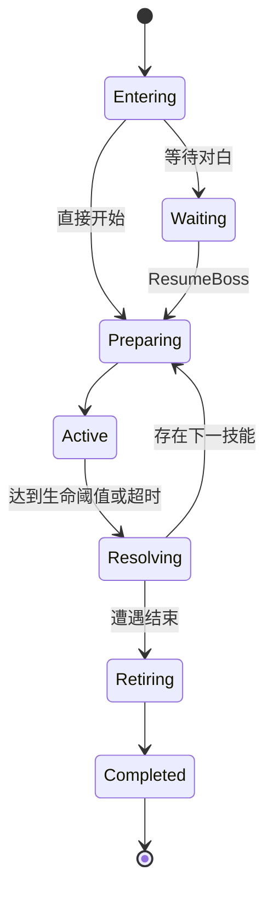

# koumakyou 详细设计说明书

## 1. 文档目的

本文档在[概要设计](OUTLINE_DESIGN.md)的模块划分基础上，定义 `koumakyou` 的关键类、接口契约、数据结构、状态机、更新时序、碰撞算法、资源生命周期、持久化策略和测试要点。文档以当前生产实现为准，未将远期数据外置方案描述成已实现功能。

## 2. `Game` 总控设计

### 2.1 职责

`Game` 是应用运行期的组合根，负责独占或协调以下对象：

- 当前 `RunState` 和开局配置。
- 当前 `StageContent` 与 `StageDirector`。
- 玩家、普通演员池、Boss、弹幕池和道具系统。
- Bomb、角色效果和外部效果。
- `AssetManager`、渲染器和音频播放。
- 设置、成绩、解锁和 Replay 会话。

`Game` 私有实现 `StageEventSink`，关卡内容只能通过该接口请求改变运行世界，不能直接访问演员池或资源管理器。

### 2.2 固定步更新

显示帧调用 `Game::Update(deltaTime)`。战斗状态把经过时间累积后，按每步 `1/120` 秒调用 `UpdateBattleStep`。单步顺序为：

1. 消费一次本步玩家输入和确认边沿。
2. 推进关卡事件与对白信号。
3. 更新玩家移动、射击意图和 Bomb。
4. 更新普通演员和 Boss 行为。
5. 消费行为产生的弹幕、子演员、道具、效果和音效请求。
6. 更新弹幕、道具及效果的运动和时钟。
7. 处理敌弹、本体、玩家弹和 Bomb 碰撞。
8. 提交玩家受击、敌方伤害、击破和 Boss 阶段结果。
9. 检查异步事件、关卡结束和退场完成。

先行为后碰撞使当帧运动和攻击能够参与判定；碰撞后立即进行阶段交接，使 Boss 能看到当帧扣血。阶段交接必须先进入准备保护，防止同一步剩余伤害穿透下一技能。

### 2.3 输入缓存

键鼠状态每个显示帧采集一次，固定战斗步按顺序消费。鼠标增量可分配到多个补算步，Bomb、确认和暂停等边沿只能消费一次，不能因一个显示帧执行多个固定步而重复触发。

## 3. 应用状态机详细设计

### 3.1 前端状态

- `MainMenu`：主入口，不持有关卡资源。
- `StartSetup`：选择难度、角色、御札、模式和练习目标。
- `ReplayList`：读取录像摘要，不加载战斗素材。
- `Options`：修改并立即保存设置。
- `MusicRoom`：按需加载单首音乐，不加载关卡图形。
- `Score`、`Credit`：展示持久化内容。

### 3.2 加载状态

`Loading` 每帧调用 `AssetManager::AdvanceStageLoad`。后台线程只读取和解码 CPU 数据，GPU 纹理、模型和音频操作仍在图形主线程完成。加载成功后调用 `CompleteStartRun`，加载失败则保留错误信息并允许返回主菜单。

加载耗时不得计入关卡时间，鼠标捕获和战斗输入只在素材完全就绪后启用。

### 3.3 战斗与终局状态

- `Playing`：推进完整战斗世界。
- `Paused`：冻结战斗、对白、退场和音乐，保存暂停前状态。
- `StageClear`：奖励明细等待确认或超时，不推进战斗。
- `Finishing`：只播放关卡退场效果，等待资源借用者清空。
- `Ending`：运行独立结局时钟和内容。
- `GameOver` / `Won`：固定终局结果。
- `ScoreSave` / `ScoreName`：选择录像或成绩槽并输入名称。

## 4. 关卡调度详细设计

### 4.1 `StageEvent` 数据结构

| 字段 | 类型 | 约束 |
| --- | --- | --- |
| `delay` | `float` | 非负有限秒数 |
| `atFrame` | `optional<int>` | 非负、60 Hz 绝对内容帧 |
| `action` | `StageAction` | 带参动作变体 |
| `id` | `optional<StageEventId>` | 仅在当前事件表内唯一 |
| `afterEndOf` | `optional<StageEventId>` | 只能引用表中更早事件 |

设置 `atFrame` 后忽略 `delay`，并禁止同时设置 `afterEndOf`。无依赖的 `delay` 相对上一事件的实际开始时间；有依赖时相对目标事件的实际结束时间。

调度器严格按表顺序处理。当前事件未到期或依赖未完成时停止扫描，不能跳过它启动后面的事件。同一帧事件的表内顺序属于演出语义。

### 4.2 动作类型

| 动作 | 同步性 | 执行规则 |
| --- | --- | --- |
| `SpawnActors` | 批次异步、调度器管理 | 最后一次请求发出即完成 |
| `StartBoss` | 异步 | 完整遭遇退场后结束事件 |
| `StartDialogue` | 异步 | 对白实际结束后结束事件 |
| `WaitDialogueSignal` | 异步 | 指定放行序号或对白结束时完成 |
| `ShowMessage` | 同步 | 立即交付提示内容 |
| `ResumeBoss` | 同步 | 恢复已存在的等待中 Boss |

`StartBoss`、`StartDialogue` 和 `WaitDialogueSignal` 必须带 `id`。内容或游戏在真实完成时调用 `StageDirector::EndEvent(id)`，不能用估算时长代替。

### 4.3 批次出怪

`SpawnActors` 的 `count >= 1`，`interval` 为非负有限秒数。第一只在事件开始时立即请求；零间隔时同一步交付全部请求；跨更新时补发所有已经到期的请求。每次向 `StageContent` 交付的规范动作都具有 `count == 1`。

批次不等待演员死亡。演员池已满时，本次请求丢弃，但事件时间和后续请求不延期。

### 4.4 取消语义

`CancelEnemySpawns()` 只取消已经开始批次中尚未交付的请求，不取消未来事件，也不清除现存演员。Boss 入场、对白开始和不同关卡可以使用不同清场策略，差异必须通过动作参数或内容接口表达。

## 5. 普通演员详细设计

### 5.1 生成链

```text
StageEvent
→ SpawnActors
→ StageContent::HandleEvent
→ Game::SpawnStageActor
→ ActorPool::Spawn
→ Actor::Activate / Follow
```

### 5.2 `behavior::Pattern`

`Pattern` 是无可变运行状态的共享配方，保存：

- `movement::Path` 移动关键帧。
- 可选 `skill::TimedShot`。
- 可选命名 `behavior::Routine` 协程入口。
- 动画、发射偏移、击破效果和逻辑寿命。
- 难度配置回调及清场响应。

简单一次性行为使用路径和定时技能；复杂循环、随机分支、多轮攻击和阶段准备使用命名协程。通用行为不能依赖具体关卡或原脚本操作码。

### 5.3 `behavior::Spawn`

`Spawn` 按值保存单只演员的出生配置，包括位置、配方、HP、分数、掉落、镜像、随机横坐标、固定种子、外观、判定半径和资源基址。出生时先执行有效性校验，再复制到演员槽位。

随机横坐标只在出生时求值一次；固定种子必须由内容显式给出，不从事件表行号推导。对象池槽位复用时必须销毁旧协程并重置所有执行状态。

### 5.4 行为时序

每个固定更新步保持以下顺序：

1. 应用上一帧计算出的位移。
2. 执行当前行为和子行为。
3. 计算下一帧速度和状态。

`Follow` 在同一时刻先应用移动变化再发弹。子行为执行期间父时钟冻结；子行为返回后，父行为可在同一更新步继续。阶段总时钟独立推进，切换阶段时不得丢失尚未消费的逻辑时间。

## 6. Boss 详细设计

### 6.1 类结构与所有权

`Boss` 提供通用运行接口；`ConfiguredBoss` 独占一个 `behavior::Actor`、已解析技能和启动配置；角色类负责解析自己的行为与技能。`Game` 使用 `unique_ptr<Boss>` 独占当前遭遇。

同一角色在不同关卡复用同一个角色类。例如五、六面的咲夜都由 `SakuyaBoss` 实现，差异由不同 `StartConfig` 表达。

### 6.2 启动配置

`StartConfig` 定义：

- 入场、等待、恢复和退场行为。
- 阶段数组及每阶段技能顺序。
- 击破和超时后的 `Next`、`Exit` 或 `Jump`。
- 血条段的技能索引、比例、颜色和排列。
- 音乐切换、完成分数及奖励。

技能 HP、预留生命、时限和符卡编号由角色 `ResolveSkill` 从角色数据绑定，关卡配置不得覆盖技能生命。

### 6.3 运行编号

- `phase`：配置阶段，1 起算。
- `skill`：阶段内技能，1 起算。
- `attack`：全部阶段展开后的技能序号，1 起算。
- `Jump` 参数：阶段和技能均为 0 起算配置索引。

入场、完整退场和未启动状态下，运行编号为 0。

### 6.4 阶段机



阶段交接先固定击破或超时原因，再停止旧行为、执行清弹和奖励、应用下一技能的准备保护，最后开放伤害。行为只报告完成原因，不自行选择下一技能。

### 6.5 血条

每个血条段显式绑定本阶段的 `skillIndex`、正比例和 RGBA 颜色；同一阶段的比例总和必须为 1。血条是只读展示，不能反向决定技能 HP 或阶段结束。

## 7. 弹幕系统详细设计

### 7.1 对象池

`BulletSystem::kCapacity` 为 16384。系统启动时一次性在堆上建立 `FixedPool`，生成和更新过程中不扩容。池满时 `Spawn` 返回空指针并增加丢弃统计。

### 7.2 `Bullet` 关键字段

| 字段组 | 内容 |
| --- | --- |
| 身份 | `active`、`generation`、`owner`、`visual` |
| 空间 | `position`、速度、方向、姿态、加速度 |
| 判定 | `radius`、光束长度、危险时窗、擦弹状态 |
| 生命周期 | `age`、`maxAge`、显现和过期状态 |
| 行为 | 追踪、转向、反弹、极坐标运动、旋转 |
| 自机攻击 | 类型、单次/持续伤害、爆破半径、武器代号 |
| 动画 | 原生类型、颜色、动画游标和显示缩放 |

位置和半径使用世界单位；速度为世界单位/秒；角速度和追踪转向速度为弧度/秒。

### 7.3 安全句柄

每次复用槽位时分配新的 `generation`。`Handle` 保存所属系统、槽位和代号；解析时三者必须匹配。清池不重置代号序列，从而保证旧句柄不会指向清池后新生成的弹幕。

### 7.4 普通弹更新

普通弹按有效秒数依次处理显现、加速、延迟转向、反弹、追踪和位置积分。非零速度更新方向和三维姿态；零速度保留最后有效朝向。达到寿命或越界后回收。

已发射弹幕保存自身运动参数副本。角色换阶段或清弹不得修改其他仍活动弹幕的配置。

### 7.5 光束

光束以起点、单位轴向、长度和半径形成线段胶囊体。生命周期分为预警、展开、危险和收束阶段。预警期可以绘制但不造成命中或擦弹；碰撞和表现读取同一危险时窗。

## 8. 碰撞与结算详细设计

### 8.1 空间几何

| 对象 | 几何模型 |
| --- | --- |
| 玩家 | 球体，球心等于相机位置 |
| 普通敌人和 Boss | 独立世界球体判定 |
| 普通弹 | 球形兼容判定或模型危险几何 |
| 光束 | 线段胶囊体 |
| Bomb | 按机体定义的动态空间体积 |

表现尺寸和碰撞尺寸分开配置，不能从 PNG 透明边界或模型外观临时推导伤害半径。

### 8.2 擦弹

擦弹使用大于受击半径的危险范围。普通弹对玩家只计一次擦弹；光束在持续阶段每 12 个 60 Hz 内容帧允许一次擦弹。120 Hz 的两个半步不能重复消费同一个内容帧。

### 8.3 玩家受击

`ResolveCollisions` 合并同一步内敌弹、光束和敌人本体的接触，只提交一次 Miss。复活、Bomb 保护和调试无敌期间不结算受击；对白及明确不可接触的 Boss 阶段不进行本体伤害。

### 8.4 敌方受伤

玩家普通弹命中后失活；导弹可转为爆破；激光和爆破按本步有效秒数造成持续伤害。Boss 准备期和退场期不可受伤。碰撞在行为更新后执行，因此阶段机能够读取本步最新生命值。

### 8.5 Bomb

Bomb 请求先校验库存和状态，再提交消耗、保护和空间攻击。Bomb 伤害由真实体积接触产生，不把视觉效果直接当作全场命中。清弹只处理允许清除的敌弹，不重置演员后续攻击状态。

## 9. 玩家、道具和分数设计

### 9.1 玩家状态

玩家保存位置、上一位置、yaw、pitch、移动速度、碰撞半径、射击冷却、无敌计时、Power 和武器状态。相机位置就是判定中心，视觉偏移不改变碰撞位置。

组合移动方向先归一化，避免斜向速度增大。Focus 使用机体定义的低速倍率。pitch 限制在可用范围内，不提供自由滚转。

### 9.2 掉落

敌人出生配置直接给出分数和掉落规则。击破时由掉落系统确定 P 点和分数点数量；自然退场、清场和池复用不能伪装成击破奖励。

普通道具先上抛后下落；玩家进入自动吸取区域后，道具持续追踪玩家。追踪状态只在拾取或清场时结束。

### 9.3 Power 与满火力

Power 限定在 8～128。首次从未满达到 128 时显示提示并把当前敌弹转换为自动吸取星点。满级后继续获得 P 点不重复触发；Miss 后降低 Power，再次升满可以重新触发。

## 10. 资源与音频详细设计

### 10.1 所有权

`AssetManager` 独占纹理、模型、着色器、字体、Music 和 Sound。渲染器、演员动画和内容模块只能借用资源 ID、游标或只读引用，不得自行释放资源。

### 10.2 通用资源

`LoadCommon` 在程序启动时加载标题、天空盒、字体和公共资源；重复调用无副作用。通用资源在 `AssetManager` 析构时释放。

### 10.3 关卡资源

`BeginStageLoad` 启动后台读取和解码；`AdvanceStageLoad` 每帧在主线程上传有限数量的纹理或模型；全部完成后绑定外观、着色器和音频。清单及字符串存储必须覆盖整个加载任务。

### 10.4 卸载顺序

1. 停止关卡流程和对应音乐。
2. 清除演员和旧协程。
3. 销毁 Boss。
4. 清除弹幕、道具、Bomb 和效果。
5. 清除动画游标及其他借用。
6. 调用 `UnloadStage` 释放关卡资源。

不得先卸载资源再等待退场效果结束。

### 10.5 音频

BGM 使用流式 Music；音效使用 Sound。菜单、道中、Boss、事件和音乐室曲目具有独立音乐槽。切换音乐时先停止旧流，再播放新流；暂停和恢复与游戏暂停同步。BGM 音量、演出增益和 SE 音量分别控制。

## 11. Replay 详细设计

### 11.1 数据结构

- `Header`：随机种子、御札、残机、Bomb、练习及挑战标志。
- `Frame`：一次逻辑更新的 `dt`、玩家输入、确认和快进标志。
- `Segment`：关卡身份、输入范围、入口资源、Rank 和结果。
- `Result`：分数、残机、Power、Miss、Bomb 和胜负。
- `Data`：完整会话、路线、版本、构建标识及片段数组。

Replay 不序列化纹理、指针、协程或完整世界快照。

### 11.2 兼容性

播放前依次验证文件边界、协议内容、路线、入口、模拟版本和内容版本。未知组合直接拒绝，不回退到相似关卡或默认配置。显示和镜头改动可不改变模拟版本，玩法与内容改动必须更新对应标识。

### 11.3 文件安全

系统提供 1～60 的固定槽位。保存时先写入临时文件并完成校验，再原子发布；覆盖必须由调用方明确确认。读取失败时不修改已有内存数据。

## 12. 设置和成绩设计

设置保存 FPS、BGM/SE 音量、鼠标灵敏度、键位、辅助瞄准和开局资源。可即时生效的设置在修改后立即保存。

成绩按难度、角色、御札、模式和目标范围区分。主线、整关练习、Extra 和符卡练习不得共享同一成绩键。调试无敌、预览和非标准环境不得写入正式成绩。

## 13. 异常与边界处理

| 场景 | 处理策略 |
| --- | --- |
| 非法关卡、难度或入口 | 抛出参数错误或拒绝确认 |
| 事件依赖非法 | 构造或启动时拒绝事件表 |
| 行为配方无效 | 生成前校验并拒绝出生 |
| 演员池满 | 丢弃本次请求，不延后时间轴 |
| 弹幕池满 | 返回空并记录丢弃统计 |
| 资源加载失败 | 留在加载页，提供返回路径 |
| Replay 不兼容 | 显示中文错误，不启动战斗 |
| 设置或成绩保存失败 | 保留内存结果和原文件 |
| 窗口失焦 | 自动暂停，不补算后台时间 |
| 关卡退出 | 完成借用者清理后再卸载资源 |

## 14. 测试详细设计

### 14.1 单元测试

- 三维方向、旋转、瞄准和空间距离。
- 定长池申请、回收和代号句柄。
- 设置、键位、成绩和 Replay 边界。
- 球体、光束、模型弹和连续碰撞。
- 动画、资源 ID 和数据校验。

### 14.2 行为测试

- 60 Hz 与 120 Hz 更新结果的内容帧一致性。
- 120 Hz 半帧移动和技能时序。
- 父子协程时钟冻结与同一步恢复。
- 随机读取顺序、固定种子和镜像路线。
- 批次出怪、取消和对象池满的语义。

### 14.3 Boss 测试

- 入场、等待、准备、攻击和退场状态。
- 击破与超时的不同跳转。
- 准备期立即保护和同帧伤害交接。
- 血条段比例、颜色和技能绑定。
- 符卡取得、Miss/Bomb 失败及奖励只结算一次。

### 14.4 集成测试

- 一至六面和 Extra 的完整事件依赖。
- 连续切关与 Easy 第五面终点。
- 对白、Boss、奖励、结局和 Replay 的衔接。
- 暂停和失焦时全部逻辑时钟冻结。
- 关卡资源在演员、Boss、弹幕和效果清空后释放。

### 14.5 验收精度

离散状态和事件顺序精确比较；世界位置允许不超过 `5e-4` 世界单位的累计舍入误差。误差容限不得用于掩盖提前或延后的事件、随机分支变化及少发或多发弹幕。

## 15. 构建与验证命令

```bash
cmake --build build-debug --target koumakyou koumakyou_tests -j 6
ctest --test-dir build-debug --output-on-failure
cmake --build build-debug --target koumakyou_lifecycle_tests -j 6
./build-debug/koumakyou_lifecycle_tests /tmp/stage-lifecycle
```

涉及完整遭遇、图形资源或生命周期的修改除单元测试外，还应运行相应图形集成目标。若因环境限制不能运行，应在交付说明中记录未完成的检查及原因。
