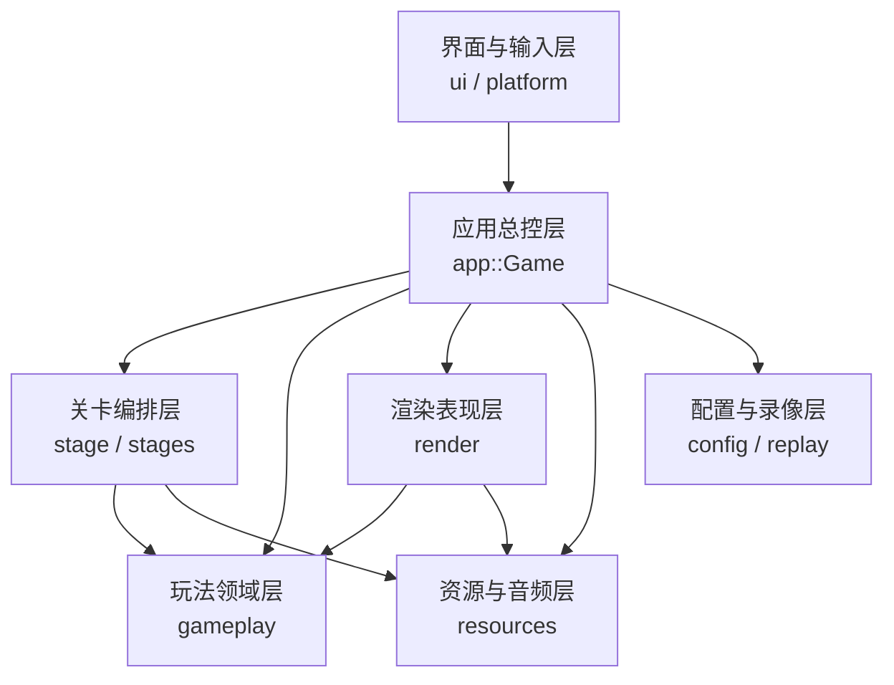
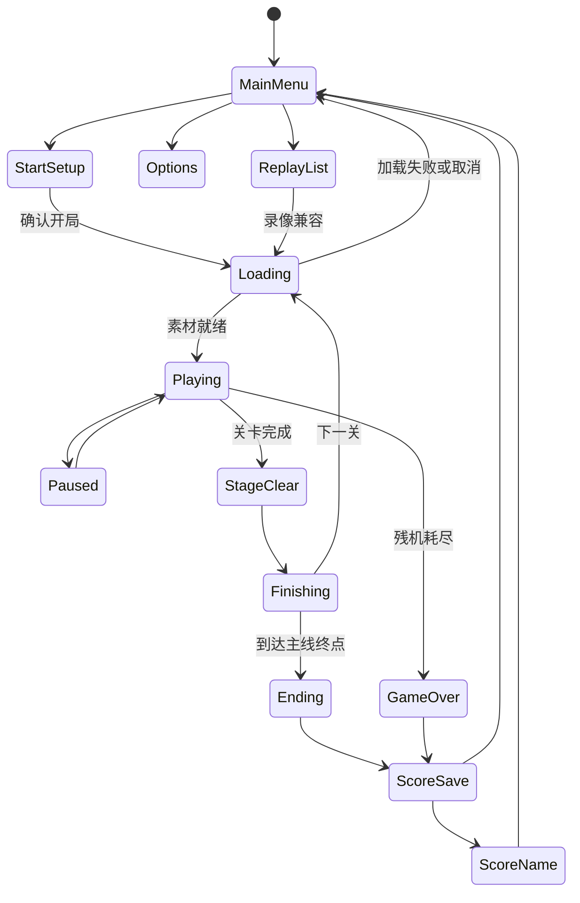
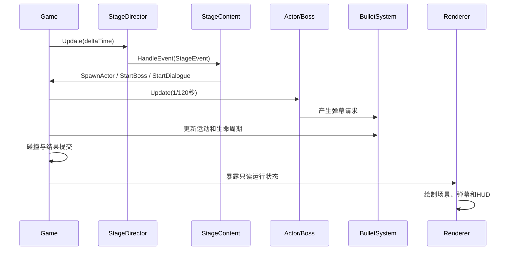

# koumakyou 概要设计说明书

## 1. 文档目的

本文档在[原型系统设计](PROTOTYPE_SYSTEM_DESIGN.md)确定的功能范围上，说明 `koumakyou` 的总体架构、模块划分、依赖关系、运行流程、数据组织、部署方式和质量策略，为详细设计和实现维护提供模块级依据。

## 2. 设计原则

1. 关卡内容与通用玩法分离：关卡模块声明“发生什么”，玩法模块实现“如何执行”。
2. 调度与对象分离：`StageDirector` 不持有敌人、Boss 或资源对象。
3. 逻辑与表现分离：碰撞和结算使用玩法状态，渲染只读取结果。
4. 定义与状态分离：静态配方可共享，可变执行状态由每个运行实例独占。
5. 时间语义明确：生产行为按 120 Hz 更新，内容事件仍按 60 Hz 帧解释。
6. 资源所有权明确：资源管理器独占 GPU 和音频句柄，其他模块仅在规定生命周期内借用。
7. 固定容量优先：战斗热路径使用定长对象池，避免不可控分配和指针失效。
8. 可验证优先：移植内容保留独立参考程序和差分测试，不让生产实现成为自身期望值。

## 3. 总体架构

### 3.1 分层结构

### 3.2 依赖约束

- `app` 可以协调其他层，但具体关卡数据必须由 `stage/stages` 提供。
- `stage/system` 只解释事件和依赖，不实现具体移动、攻击或素材选择。
- `stages/stageN` 可以复用 `gameplay` 的通用能力，`gameplay` 不反向依赖关卡编号。
- `render` 不修改战斗判定状态，不以视觉大小替代碰撞参数。
- `resources` 不决定关卡流程，关卡只通过清单请求资源。
- `tests/reference_*` 是独立基准，不链接回生产引擎。

## 4. 模块划分

| 模块 | 主要职责 | 关键接口或对象 |
| --- | --- | --- |
| `src/app` | 状态机、输入、战斗更新、切关、结算 | `Game`、`RunState` |
| `src/stage` | 事件模型、时间轴调度、内容注册 | `StageEvent`、`StageDirector`、`StageContent` |
| `src/stages` | 各关事件、敌人、Boss、对白、场景和素材 | `stage1`～`stage6`、`stage_extra` |
| `gameplay/actors` | 玩家、普通演员、移动、技能和行为 | `Player`、`Actor`、`ActorPool` |
| `gameplay/bosses` | 角色 Boss、技能解析和阶段机 | `Boss`、`ConfiguredBoss` |
| `gameplay/bullets` | 弹幕创建、更新、光束和回收 | `Bullet`、`BulletSystem` |
| `gameplay/collision` | 弹体、球体和胶囊体碰撞 | `ProjectileCollision` |
| `gameplay/combat` | 伤害、Rank 和结算规则 | `DamageRuleProvider` |
| `gameplay/items` | 掉落、运动、吸取和拾取 | `DropSystem` |
| `gameplay/effects` | Bomb、击破和外部效果 | `PlayerBombEffect`、`ActorEffectSystem` |
| `resources` | 通用/关卡资源及音频生命周期 | `AssetManager` |
| `render` | 三维世界、精灵、弹体、HUD 和页面 | `CombatRenderer`、`SpriteRenderer` |
| `config` | 设置、键位和最高成绩 | `SettingsData`、`HighScores` |
| `replay` | 输入录像、兼容校验和文件读写 | `replay::Data` |
| `narrative` | 结局内容和演出 | `Ending` |
| `tests` | 单元、参考差分和集成验证 | CTest 测试目标 |

## 5. 应用状态设计

### 5.1 状态集合

`RunState` 包含以下状态：

- 前端：`MainMenu`、`ReplayList`、`Options`、`StartSetup`、`MusicRoom`、`Score`、`Credit`。
- 加载：`Loading`。
- 关卡：`Playing`、`Paused`、`StageClear`、`Finishing`。
- 终局：`Ending`、`ScoreSave`、`ScoreName`、`Won`、`GameOver`。

### 5.2 状态转换

暂停保留原战斗状态，不创建第二份世界。暂停期间停止战斗、对白、退场和结算倒计时，同时暂停当前音乐。

## 6. 关卡架构

### 6.1 关卡接口

`StageContent` 是关卡内容的抽象入口，提供：

- 关卡素材清单。
- 静态事件表。
- Boss 工厂和练习入口。
- 玩家及敌方外观映射。
- 对白、演出指令和流程规则。
- 场景绘制和关卡显示信息。
- 可选伤害规则与原始数值目录。

`StageEventSink` 由 `Game` 实现，将内容动作转换为演员生成、Boss 创建、对白开始和消息显示。

### 6.2 关卡目录

`stage/catalog.*` 负责 `StageId`、可用难度、入口校验和内容工厂。新增可玩关卡时，只在目录和构建配置中登记，不在总控中建立新的关卡类分支。

### 6.3 单关目录职责

| 文件 | 职责 |
| --- | --- |
| `timeline.cpp` | 显式事件表及其触发顺序 |
| `behaviors.*` | 普通演员命名配方和协程 |
| `boss_config.*` | 技能组合、跳转、血条和奖励 |
| `dialogue.cpp` | 台词与对白演出指令 |
| `manifest.cpp` | 图片、动画、模型、音乐和音效清单 |
| `scenery.*` | 背景与环境动画 |
| `content.*` | `StageContent` 的关卡实现 |
| `ids.hpp` | 本关稳定内容和资源编号 |

## 7. 玩法系统协作

### 7.1 一帧数据流

### 7.2 普通演员

普通演员采用配方与实例分离：`behavior::Pattern` 保存可共享定义，`behavior::Spawn` 保存单只出生数据，`Actor` 独占运动、技能、随机数、动画和协程状态。

### 7.3 Boss

`ConfiguredBoss` 解析关卡提供的 `StartConfig`，角色子类通过 `ResolveSkill` 绑定真实技能生命、时限和符卡信息。关卡配置只定义组合、跳转、血条、入退场及奖励。

### 7.4 弹幕

`BulletSystem` 独占固定弹幕池，负责创建、运动、追踪、光束、过期和越界回收。攻击图案由演员技能生成，弹幕系统不依赖具体关卡。

## 8. 数据设计概览

### 8.1 静态定义

- `StageEvent`：关卡触发和动作。
- `behavior::Pattern`：普通演员共享行为配方。
- `behavior::Spawn`：单只演员出生配置。
- `bosses::Battle` / `StartConfig`：Boss 完整遭遇配置。
- `StageAssetManifest`：关卡资源清单。
- `DialogueLine` / `DialogueCue`：对白和演出指令。

静态定义在运行期间只读，其存储期必须覆盖对应调度器、演员或资源借用期。

### 8.2 运行状态

- `Game`：本局流程和各系统所有权。
- `Player`：位置、视角、资源、冷却和无敌状态。
- `ActorPool`：普通演员实例。
- `Boss`：当前活动遭遇。
- `BulletSystem`：玩家弹和敌弹。
- `DropSystem`：普通道具和星点。
- `StageDirector`：关卡时钟、事件进度和批次进度。
- `replay::Data`：本次录像配置、逻辑输入和结果。

### 8.3 持久化数据

- 设置：FPS、音量、灵敏度、键位、开局资源等。
- 成绩：主线、关卡练习、Extra 和符卡记录。
- Replay：协议头、关卡片段、输入帧、版本和结果。

设置、成绩和录像相互独立；恢复设置默认值不得清除成绩或 Replay。

## 9. 时间与空间约定

- 世界 X 为横向，Y 为高度，Z 为纵深。
- 敌人通常从 `+Z` 向 `-Z` 推进。
- 位置和长度使用世界单位。
- 速度使用世界单位/秒，加速度使用世界单位/秒²。
- 角度和角速度使用弧度与弧度/秒。
- 关卡绝对帧和行为内容帧按 60 Hz 解释。
- 生产演员和 Boss 按 120 Hz 更新，每步推进 0.5 内容帧。
- UI 和加载进度使用秒，不作为战斗逻辑帧。

## 10. 资源与音频架构

### 10.1 资源分组

- 通用资源：标题、字体、天空盒和公共音效，程序启动后持续存在。
- 关卡资源：本关图集、模型、着色器、对白立绘和音乐，按关卡加载。
- 按需资源：战斗图集和音乐室曲目，只在需要时载入。

### 10.2 加载策略

关卡加载采用后台读取和解码、主线程分帧上传。资源完全就绪后才创建战斗对象并启动关卡时钟。

### 10.3 卸载策略

离开关卡前依次停止流程、清除演员、Boss、弹幕、道具和效果，再卸载关卡资源。该顺序保证所有借用在资源释放前结束。

## 11. 部署设计

系统是无需服务器的桌面应用。运行目录由可执行程序、`assets`、设置文件、成绩文件和 `replays` 目录组成。构建系统只把运行时素材复制到输出目录，源素材、测试报告和生成缓存不进入发布包。

## 12. 性能与可靠性策略

- 弹幕池固定为 16384 槽，普通演员池固定为 128 槽。
- 弹体状态存储在堆上的定长池中，避免线程栈溢出。
- 战斗更新与渲染分离，显示帧只决定绘制密度。
- BGM 在加载阶段由 FLAC 解码为 PCM，音频回调按原作循环点持续取样。
- 对象句柄使用槽位代号，防止复用后旧引用误指向新对象。
- 文件保存使用临时文件与原子发布策略。
- 加载失败保留错误页面，不进入半初始化战斗。

## 13. 测试架构

| 层级 | 验证内容 |
| --- | --- |
| 单元测试 | 数学、对象池、设置、输入、碰撞、动画和协议 |
| 行为测试 | 移动、发弹、协程、120 Hz 半帧语义 |
| 参考差分 | 60 Hz 原作脚本、出生参数和 Boss 攻击 |
| 集成测试 | 完整遭遇、暂停、结算、切关和资源生命周期 |
| 图形审阅 | 弹体模型、激光、HUD 和高弹量性能 |

详细接口、状态不变量和算法见[详细设计](DETAILED_DESIGN.md)。
