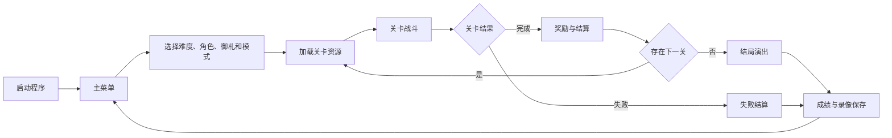

# koumakyou 原型系统设计说明书

## 1. 文档目的

本文档说明 `koumakyou` 三维第一人称弹幕射击系统的原型目标、用户范围、核心功能、交互流程和验收标准，用于课程项目立项、原型评审及后续设计工作的共同依据。

本文所述原型以仓库当前可运行实现为准。系统已经覆盖一至六面主线、独立 Extra、整关练习、部分符卡练习和 Replay，不把早期单场景演示当作当前系统边界。

## 2. 项目背景与系统定位

传统弹幕射击游戏主要在二维平面中组织角色移动和弹幕图案。本项目使用 C++20 与 raylib 构建三维长方体战场，将弹幕的方向、速度、碰撞和躲避路线扩展到三维空间，并采用第一人称视角表现玩家在弹幕中的移动过程。

原型系统重点验证：

- 第一人称三维移动是否适合弹幕躲避。
- 二维弹幕节奏和图案特征能否转写为三维空间行为。
- 关卡时间轴、普通敌人和多阶段 Boss 是否能够由内容模块独立编排。
- 高弹量场景能否通过固定对象池稳定运行。
- 固定逻辑时钟能否保证不同显示帧率下的玩法一致性。
- 关卡资源能否安全加载、切换和卸载。
- 主线、练习、结算、录像等外围流程能否组成完整可玩闭环。

## 3. 原型目标

### 3.1 功能目标

1. 提供主菜单、设置、开局配置、加载、战斗、暂停、结算和成绩保存流程。
2. 支持键盘三轴移动、鼠标视角、射击、低速移动和 Bomb。
3. 支持普通弹、追踪弹、激光、转向、加速、反弹和三维散射。
4. 支持关卡时间轴连续出怪、对白、道中 Boss 和关底 Boss。
5. 支持 Boss 入场、准备、普通攻击、符卡、超时、击破及退场。
6. 支持残机、Bomb、Power、分数、擦弹、掉落和自动吸取。
7. 支持 Easy、Normal、Hard、Lunatic 主线，以及独立 Extra。
8. 支持整关练习、符卡练习和输入型 Replay。

### 3.2 质量目标

- 战斗逻辑不依赖显示帧率。
- 暂停、失焦和加载期间不推进战斗时钟。
- 高弹量场景中不在热路径动态扩充对象池。
- 切关时不存在对已卸载纹理、动画或音频的继续借用。
- 设置、成绩和 Replay 保存失败时不破坏原有文件。
- Windows 与 macOS 共用核心玩法代码。

### 3.3 非目标

原型当前不以联网对战、云端存档、用户生成关卡和跨平台逐位确定性为目标。三维适配保留原作主要节奏与行为特征，但不要求所有表现与二维原作逐像素一致。

## 4. 目标用户

| 用户类别 | 主要诉求 |
| --- | --- |
| 普通玩家 | 完成主线、Extra、练习和符卡挑战 |
| 弹幕游戏爱好者 | 体验三维空间中的弹幕图案和 Boss 战 |
| 项目开发者 | 扩展关卡、角色行为、弹幕和素材 |
| 测试人员 | 核对时序、碰撞、资源生命周期和 Replay 一致性 |
| 课程评审人员 | 查看需求、设计、实现和测试之间的对应关系 |

## 5. 原型范围

### 5.1 游戏模式

- 主线模式：Easy 在第五面结束，Normal、Hard、Lunatic 运行至第六面。
- Extra：使用独立入口、关卡流程和结算记录。
- Practice Start：从指定关卡入口开始，结束后返回选关页面。
- Spell Practice：从指定 Boss 技能的准备阶段开始。
- Replay：录制或播放主线、单关和符卡练习的逻辑输入。

### 5.2 功能清单

| 功能域 | 原型能力 |
| --- | --- |
| 菜单 | 开始、练习、符卡练习、Replay、音乐室、成绩、设置 |
| 开局配置 | 难度、角色、御札、模式和最终确认 |
| 玩家 | 6DoF 移动、视角、射击、Focus、Bomb、复活 |
| 关卡 | 绝对帧和依赖事件、批次出怪、对白与 Boss 衔接 |
| 敌人 | 路径移动、定时攻击、循环协程、召唤和退场 |
| Boss | 多阶段技能、显式血条、符卡奖励、击破和超时 |
| 弹幕 | 球形弹、模型弹、光束、追踪、转向、反弹 |
| 战斗 | 受击、伤害、擦弹、掉落、Power、分数、Rank |
| 表现 | 三维场景、精灵、弹体模型、HUD、对白、结局 |
| 数据 | 设置、键位、成绩、解锁、符卡记录和 Replay |

## 6. 原型交互设计

### 6.1 主流程

### 6.2 基本操作

| 输入 | 功能 |
| --- | --- |
| W、A、S、D | 水平移动 |
| Space、Left Shift | 上升、下降 |
| 鼠标移动 | 改变第一人称视角 |
| 鼠标左键 | 射击或确认 |
| 鼠标右键 | Focus／低速移动或返回 |
| F | 使用 Bomb |
| Esc、P | 暂停或继续 |
| Z、Enter | 菜单确认、推进对白 |
| X | 返回上一级 |

键位允许在设置页面重新绑定，实际运行以保存后的键位配置为准。

### 6.3 界面原型

界面分为三类：

1. 菜单页面：使用响应式布局，支持键盘和鼠标操作。
2. 战斗 HUD：展示关卡题签、分数、残机、Bomb、Power、Boss 血条和符卡信息。
3. 模态界面：暂停、对白、关卡奖励、结局和成绩命名覆盖在当前流程上。

## 7. 技术原型

| 项目 | 方案 |
| --- | --- |
| 编程语言 | C++20 |
| 图形、音频和输入 | raylib |
| 构建系统 | CMake |
| 平台 | Windows、macOS |
| 内容组织 | C++ 静态事件表、命名行为配方、角色专属 Boss 模块 |
| 逻辑更新 | 生产战斗按 120 Hz 固定补算 |
| 内容时间 | 关卡、技能和原作脚本保持 60 Hz 内容帧语义 |
| 内存策略 | 普通演员、弹幕和道具采用定长对象池 |
| 测试 | 单元测试、参考差分、完整遭遇及图形生命周期测试 |

## 8. 原型数据与容量约束

- 战场基准尺寸为 20×20×23 世界单位。
- 玩家相机位置同时作为玩家球形判定中心。
- 普通演员池容量为 128。
- 弹幕池容量为 16384。
- 普通道具池容量为 1024。
- Replay 固定槽位为 60，单个录像最多保存 2,000,000 个逻辑输入帧。
- Power 范围为 8～128。
- 位置使用世界单位，速度使用世界单位/秒，加速度使用世界单位/秒²，角度使用弧度。

## 9. 原型验收标准

### 9.1 功能验收

- 能从主菜单完成一次合法开局并进入关卡。
- 能完成普通敌人波次、对白和 Boss 战的完整流程。
- 击破、超时、受击、Bomb、掉落和结算结果符合配置。
- 主线能够切换关卡并在终点进入结局。
- 练习结束后返回正确页面，不污染主线记录。
- Replay 能保存、加载并拒绝不兼容内容。

### 9.2 一致性验收

- 关卡内容帧不随显示帧率变化。
- 120 Hz 行为更新不会令 60 Hz 内容时序加速。
- 暂停后演员、弹幕、对话、背景和结算倒计时均冻结。
- 同一逻辑步的多个玩家命中只结算一次 Miss。

### 9.3 生命周期验收

- 加载完成前不启动战斗计时。
- 退出或切关前先清除演员、Boss、弹幕、道具及效果。
- 关卡素材卸载后不存在旧动画、纹理或音频借用。
- 保存失败不覆盖原有设置、成绩或 Replay。

## 10. 后续设计输入

本原型确认的功能边界由[概要设计](OUTLINE_DESIGN.md)分解为系统架构和模块职责，再由[详细设计](DETAILED_DESIGN.md)定义关键接口、数据约定、状态机、算法和异常处理。
