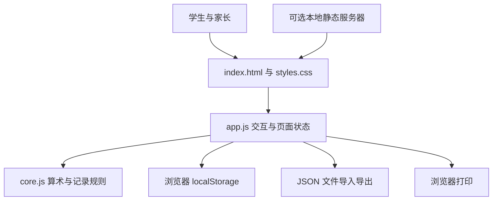
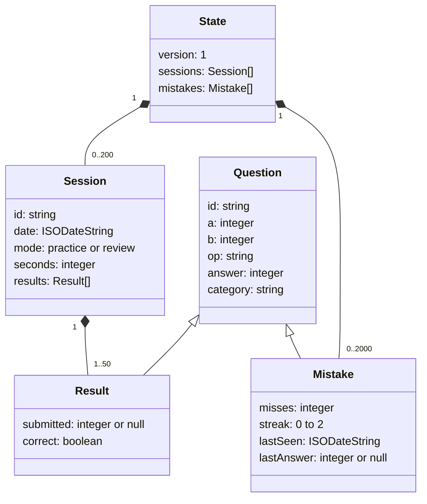
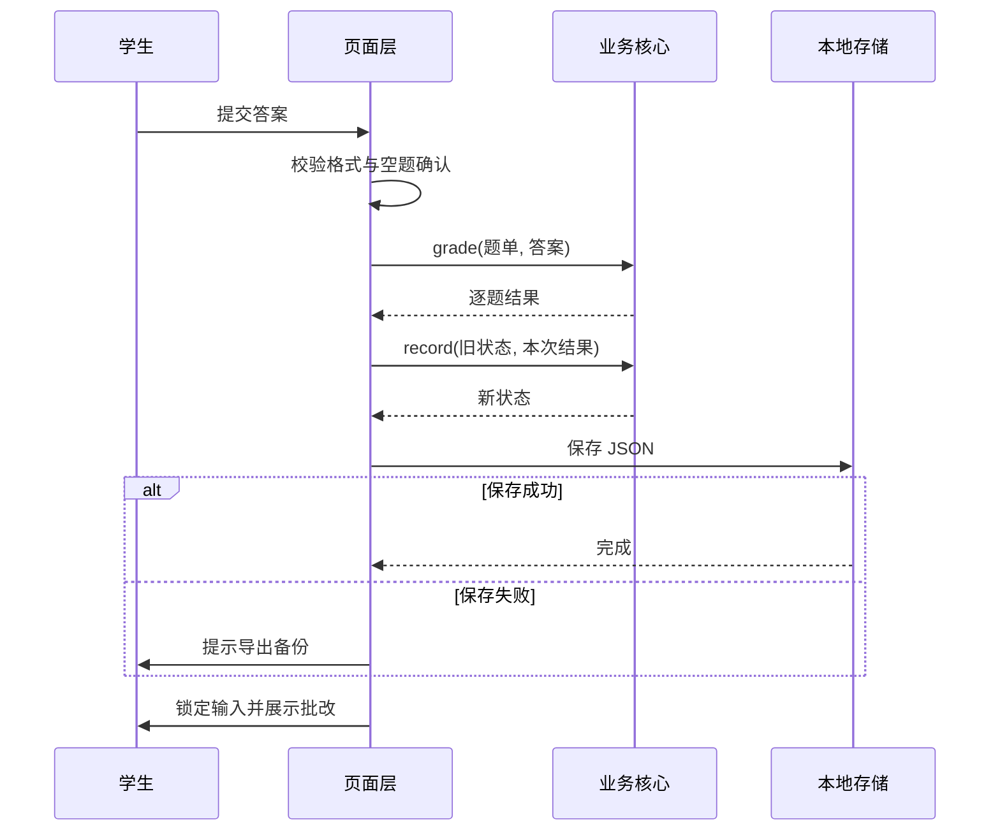
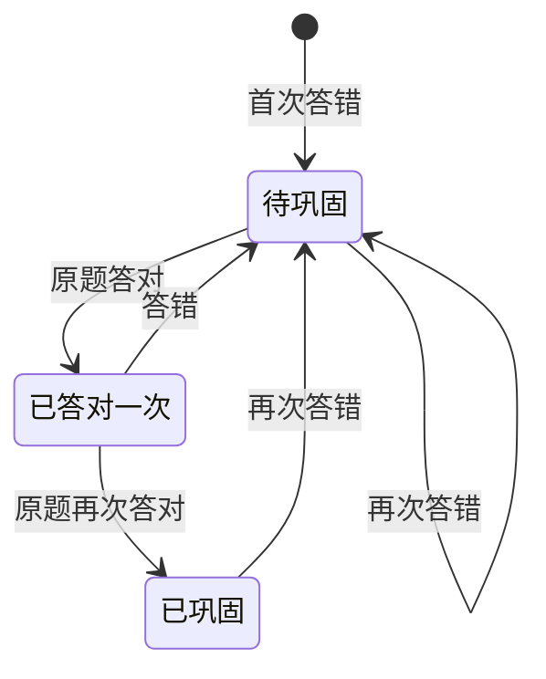

# 小芽口算系统设计

版本：1.0.0。本文对应当前源码，不假设存在后端数据库、用户认证或云同步。

## 1 架构与设计决策



选择原生 HTML/CSS/JavaScript 的原因是规模有限、需要离线调试、避免依赖安装。业务核心不访问 DOM，可以直接被 Node 测试；页面层负责输入、提示、显示与存储。无需数据库服务器，数据使用小规模 JSON。代价是只支持单浏览器单孩子，无法自动跨设备同步。

静态服务仅用于本机固定站点来源，不承担业务 API。构建只复制五个运行文件，并生成 SHA-256 清单。公开部署只需静态托管。

## 2 模块与接口

| 文件或函数 | 输入 | 输出与责任 |
| --- | --- | --- |
| `core.validateConfig` | max、count、operations、carry | 合法配置或错误信息 |
| `core.buildPool` | 合法配置 | 满足规则的有限题库 |
| `core.generate` | 配置、可注入随机数函数 | 不重复且尽量均衡的题单 |
| `core.grade` | 题单、题目 ID 到原始答案的映射 | 带 submitted 和 correct 的逐题结果 |
| `core.record` | 旧状态、提交结果 | 深拷贝后的新状态；同 session.id 不重复记账 |
| `core.reviewQuestions` | 学习状态、随机数函数 | 原题与同类变式题单，无可复习题时为空数组 |
| `core.validateState` | 不可信 JSON 数据 | 仅含已知字段的规范化状态，或异常 |
| `core.createTimer` | 可注入的单调时钟 | 开始/暂停、累计秒数；暂停期间不计入 |
| `core.assess` | 逐题结果、秒数 | 准确率、均时、参考均时、表现标签及建议 |
| `app.start/submit` | 页面配置、答案 | 渲染题单、阻止重复提交、展示批改、保存记录 |
| `app.save` | 新学习状态 | 写入 localStorage；失败时保留内存结果并提示 |
| `scripts/serve.cjs` | 本机 HTTP 请求 | 白名单静态资源，不公开 docs、tests 或仓库文件 |

## 3 数据模型



图中继承表达数据字段复用，源码使用普通对象而非 JavaScript class。题目 ID 为 `a:op:b`，例如 `8:+:7`。`8+7` 与 `7+8` 是不同题目，单套不重复指有序算式不重复。题型由操作数和运算推导，不能由导入文件随意指定。

练习模式 `practice` 通常 5–50 题；复习最多 20 题，可能少于 5 题。状态导入允许 1–50 题以兼容小规模复习。`seconds` 在新版本为练习页可见期间累计秒数，包含检查答案时间。可选 `timing` 字段为 `active-v1` 或 `paper-v1`；缺失时视为旧版经过时间，不进行速度评价。数据 schema 仍为 1，保持已产生记录兼容。

示例数据仅为结构演示，不是真实用户记录：

```json
{
  "version": 1,
  "sessions": [{
    "id": "example-session",
    "date": "2026-09-19T10:00:00.000Z",
    "mode": "review",
    "seconds": 12,
    "results": [{
      "id": "8:+:7", "a": 8, "b": 7, "op": "+", "answer": 15,
      "category": "进位加法", "submitted": 14, "correct": false
    }]
  }],
  "mistakes": [{
    "id": "8:+:7", "a": 8, "b": 7, "op": "+", "answer": 15,
    "category": "进位加法", "misses": 1, "streak": 0,
    "lastSeen": "2026-09-19T10:00:00.000Z", "lastAnswer": 14
  }]
}
```

## 4 关键算法

### 4.1 有限题库生成与均衡抽样

遍历各运算和范围内的操作数组合，按数学规则过滤。加法个位和大于等于 10 视作进位；减法被减数个位小于减数个位视作退位。范围最多 100，遍历复杂度为 O(kM²)，其中 k≤4，M≤100，规模可控。

题库数小于题量时立即失败，不使用不断随机重试的方法。每个运算子题库用 Fisher–Yates 洗牌；轮流从各子题库取题，子题库耗尽则跳过；最后再次洗牌题单。因此当题目充足时运算数量差不超过 1，某类不足时由其他类补足。

### 4.2 批改与幂等保存

输入去除首尾空格，匹配 1–3 位数字才转为整数，避免 `4abc` 被误判成 4。空白在页面确认后记为 `null`、错误。批改只比较整数与规则计算出的答案。

页面提交后立即锁定本次状态，同时在业务层按 session.id 检查是否已存在，避免重复统计。统计不是只保留最后一次结果；今日统计纳入本地日期相同的所有已提交练习。



### 4.3 错题状态与同类复习



从未巩固错题中随机选最多 10 道。每道原题寻找同 category、同基础范围档位的不同算式作为变式，使用 ID 集合去重。档位由原题操作数与答案最大值向上归入 10/20/50/100。无法找到变式时保留原题，不补不相关题。

「两次连续正确」是透明的产品规则，不是经过教育实验验证的掌握标准；用户反馈可驱动修订。

### 4.4 导入校验

先检查文件不超过 5 MB，再解析 JSON、校验版本、数组上限、日期、算式唯一性、算术一致性、结果布尔值和错题状态。重建白名单字段对象，丢弃未知字段。所有检查通过后才询问替换；用户取消时不更改。

### 4.5 计时与表现判断

`createTimer` 默认使用 `performance.now()`；保存已累计毫秒和当前运行段开始点。开始、暂停或每秒刷新时结算本段差值，保持毫秒精度，展示与保存时向下取整为秒。该算法不会因定时器 tick 延迟而漏算，也不会反复刷新而重复计入。

页面层根据练习是否提交、当前导航、document.hidden、确认弹窗和打印状态控制运行。提交先冻结计时，再记录结果。它衡量本页可见时长而非眼动或真实专注度，不检测用户是否在思考或离开座位。

`assess` 先判断是否有空题、准确率是否达 90%，再检查至少 5 题与至少 1 秒/题；满足时将实际秒数与按每题类型累计的参考秒数比较。判断使用原始正确比例，显示时才四舍五入。规则见需求 FR-18；打印记录和旧记录由页面层排除速度标签。评价不改变错题掌握状态。

## 5 存储、可靠性与边界

- key：`savior.math-garden.v1`。版本号为未来迁移预留；当前不接受其他版本。
- 本地存储按来源隔离，`file://`、localhost 不同端口、未来公开网址的数据不会共享。
- 初次读取损坏数据时，不自动写回覆盖原始存储；新练习仍可内存运行并导出。
- 保存失败不宣称持久化成功；页面提示刷新风险。未提交答案不保存草稿。
- 多标签页不实现事务合并；收到其他页变更事件时提示备份与刷新，手册要求单标签使用。
- 题型、运算符和数字来源于生成器或严格校验，不直接渲染任意导入文本。

## 6 构建与接口部署

`node scripts/build.cjs` 复制 `index.html`、`src/core.js`、`src/app.js`、`src/styles.css`、`src/practice.css` 至 `dist/`。无压缩或外部资源拉取。`SHA256SUMS.txt` 可用于核对文件一致性。

本地服务只支持 GET/HEAD 白名单资源，其他方法返回 405，未知路径返回 404，非法 URL 编码返回 400。仅监听 127.0.0.1。HTTPS、域名及公开托管由实际发布平台处理，本项目不提供生产服务器。
