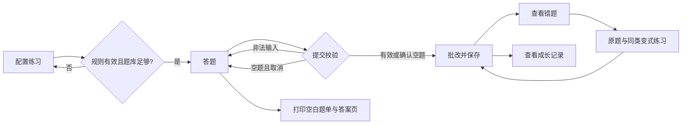

# 交互原型与页面说明

当前原型采用已实现的 HTML 页面，可运行、可交互。入口为 `savior/index.html` 或本机 http://127.0.0.1:4173。它不依赖在线原型工具。课程要求的可访问原型地址与截图需在后续发布和人工验收时补齐。

## 页面结构

```text
桌面视图
┌──────────────┬────────────────────────────────────────┐
│ 小芽口算     │ 日期与提示条                           │
│              ├────────────────────────────────────────┤
│ 今日练习     │ 引导区 / 当前页面标题                  │
│ 错题花园     │ 今日题量 | 今日正确率 | 待巩固数量      │
│ 成长记录     │ 难度预设                               │
│ 数据与帮助   │ 范围 / 数量 / 进退位 / 运算             │
│              │                        [生成练习]      │
└──────────────┴────────────────────────────────────────┘
```

移动端侧栏变为顶部导航；设置项纵向排列；题目双列显示；较长内容可纵向滚动。实际 360px、390px 和桌面布局待手动检查。

## 页面与状态

| 页面 | 主要内容 | 空状态或错误状态 |
| --- | --- | --- |
| 今日练习设置 | 三档预设、统计卡、自定义配置 | 无练习时正确率为破折号；配置无题或不足提示 |
| 正在练习 | 每题编号、算式、答案输入、进度、计时器、键盘提示、打印和提交 | 未填题需确认；非法答案定位到输入框；离开练习页暂停计时 |
| 批改结果 | 总分、逐题结果、用时与表现建议、进入错题花园 | 错误使用文字与颜色共同表达；可展开评价规则 |
| 错题花园 | 待巩固/已巩固、原题答案、类型、错误次数 | 无错题显示引导，禁用巩固按钮 |
| 成长记录 | 总统计、题型进度、可展开历史 | 无历史显示第一次练习引导 |
| 数据与帮助 | 备份、导入、数据说明、清空 | 文件错误、存储失败和替换确认 |

## 完整交互路径



切换导航不立即丢弃当前题单；重新生成、从别处启动复习、退出未提交练习时提示。浏览器刷新关闭提示是否展示取决于浏览器行为，不能保证所有环境都弹窗。

## 视觉与可用性约定

- 米白背景、绿色强调、较大的数字输入区；错误反馈用温和文字，不排名、不倒计时。
- 图形装饰使用 CSS，本地资源不依赖远程图片。
- 输入关联 label；键盘 focus-visible 可见；导航设置 aria-current；动态通知使用 live region。
- 题目等待时间不限，练习耗时只作历史记录，不作为奖惩。
- 打印使用专门的空白题单，不打印输入框已填答案；参考答案另起页。

## 待人工保留的截图

完成 `docs/testing/manual-acceptance.md` 后，可将首页、5 题作答、批改、错题花园、历史、手机布局及打印预览截图保存到 `docs/design/screenshots/`。尚无已验证截图，不用模拟截图代替实际界面证据。
