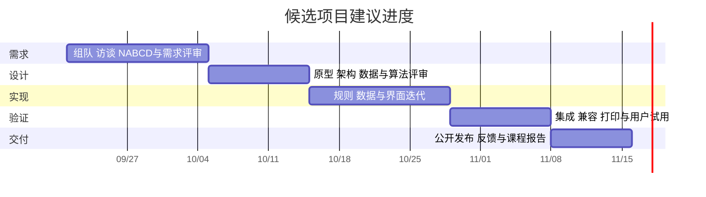

# 候选项目计划

项目：小芽口算。状态：给定第 2 题的独立候选实现，小组成员和最终选题未确定。

## 1 选题依据与可行性

学生选题系统存在多人共享状态和公平规则讨论；区块链游戏、P2P 下载主要难点包含多节点与网络环境；零知识证明工具有较高密码学验证门槛。儿童学习的用户、每日题量和反馈流程明确，基础出题与批改可以离线实现，便于验证软件过程。

软件无收费 API、数据库服务器或运行依赖，现有浏览器即可使用。主要风险是实际用户需求尚未验证、在线发布未完成、低年级不同学习阶段的范围可能不足。相比增加未经验证的功能，优先通过家长试用调整规则。

## 2 角色建议

最多四人时可按以下职责分配，暂不虚构姓名或已完成的团队工作。每人均需参与评审、测试和报告，不能把全部文档集中给某一人。

| 角色 | 主要职责 |
| --- | --- |
| A 需求与项目协调 | 访谈、需求基线、计划、版本与发布协调 |
| B 交互与页面 | 页面、输入流程、响应式、打印 |
| C 业务与数据 | 出题、批改、错题、备份校验 |
| D 质量与交付 | 测试、兼容检查、反馈、手册与发布验证 |

## 3 工作分解

共 36 项，可按 4 人每人约 9 项认领。状态「已准备」指有候选材料，不代表已经教师或用户验收。

| ID | 任务 | 建议角色 | 完成标准 | 当前状态 |
| --- | --- | --- | --- | --- |
| W01 | 比较五个给定题目 | A | 记录选择依据和风险 | 已准备 |
| W02 | 组织头脑风暴 | A | 真实会议记录和参会信息 | 待小组 |
| W03 | 绘制选题思维导图 | A | 展示用户、流程和范围 | 已准备 |
| W04 | 完成 NABCD 分析 | A | 五个问题有明确回答 | 已准备 |
| W05 | 访谈目标家庭 | A | 保存真实匿名记录 | 待用户 |
| W06 | 编写需求基线 | A | 编号、范围、验收标准齐全 | 已准备 |
| W07 | 与老师确认选题与范围 | A | 保留评审意见 | 待小组 |
| W08 | 分工与甘特图 | A | 实际认领人和日期 | 方案已准备 |
| W09 | 版本及发布协调 | A | 仓库过程、发布入口可查 | 待小组 |
| W10 | 首页与导航 | B | 页面入口和状态清楚 | 已实现待人工验收 |
| W11 | 配置表单与预设 | B | 预设、手改与校验一致 | 已实现待人工验收 |
| W12 | 答题输入与进度 | B | 输入可达、进度正确 | 已实现待人工验收 |
| W13 | 批改界面 | B | 总分与逐题反馈一致 | 已实现待人工验收 |
| W14 | 错题花园 | B | 显示状态和复习入口 | 已实现待人工验收 |
| W15 | 成长记录 | B | 历史、详情与图表可用 | 已实现待人工验收 |
| W16 | 打印样式与答案页 | B | 题单清晰，答案另页 | 已实现待人工验收 |
| W17 | 响应式与键盘体验 | B | 手机和桌面完成流程 | 已实现待人工验收 |
| W18 | 原型说明与截图 | B | 完整交互与真实截图 | 说明已准备，截图待补 |
| W19 | 配置规则验证 | C | 非法设置拒绝 | 已实现且已测 |
| W20 | 算术题库 | C | 范围、整除、进退位正确 | 已实现且已测 |
| W21 | 均衡不重复抽样 | C | 数量、唯一性和分布正确 | 已实现且已测 |
| W22 | 答案批改 | C | 零、空白与非法答案正确处理 | 已实现且已测 |
| W23 | 错题状态转换 | C | 连续正确与再次错误规则正确 | 已实现且已测 |
| W24 | 同类变式复习 | C | 原题保留，同类变式不重复 | 已实现且已测 |
| W25 | 本地历史与容量限制 | C | 幂等记录和保留上限 | 核心已测，浏览器待验收 |
| W26 | JSON 导入导出 | C | 数学和结构校验，确认替换 | 校验已测，界面待验收 |
| W27 | 架构与数据文档 | C | 文档与真实接口一致 | 已准备 |
| W28 | 编写测试计划 | D | 需求到测试映射 | 已准备 |
| W29 | 自动化核心测试 | D | 可重复执行且记录结果 | 已通过 |
| W30 | 静态服务集成测试 | D | 资源返回和非公开文件隔离 | 已通过 |
| W31 | 浏览器与离线验收 | D | 记录手动结果和环境 | 待用户执行 |
| W32 | 性能与打印验收 | D | 50题响应和打印检查 | 待用户执行 |
| W33 | 编写用户手册 | D | 首次使用可独立完成 | 已准备待试用 |
| W34 | 发布与获取方式 | D | 外部可访问网址、截图、说明 | 构建已准备，未上线 |
| W35 | 收集反馈并迭代 | D | 真实问题到修复记录 | 待用户 |
| W36 | 最终报告与8分钟展示 | D | 证据齐全，各成员体会真实 | 提纲已准备 |

## 4 课程节奏与建议进度

第一、二次课完成选题讨论和需求；第三次课前提交个人需求分析。设计以第五次课完成为内部目标，确保第六次课前提交个人设计报告。第七次课完成测试、说明与发布，第八次课展示。以教师实际通知为准。

下图为示例相对进度，用 2026-09-21 起的八周作为计划占位，不代表真实开课日期；组队后替换。

## 5 风险与处置

| 风险 | 处置 |
| --- | --- |
| 未找到真实家长 | 先联系目标用户再声称需求成立；不编写虚假调查 |
| 三年成长范围不足 | 评审现有范围，按证据增加多位数计算等内容 |
| 浏览器记录丢失 | 本地说明、定期备份、恢复校验 |
| 校园网影响演示 | 保留本地完整版本，演示使用本机固定地址 |
| 在线试用未完成 | 将公开网址、外部访问和保留期限列为独立发布门槛 |
| Gitee过程要求未满足 | 当前 GitHub 私有仓库不能自动替代，和老师确认或增加 Gitee 镜像及 Wiki |
| 功能完成但课程证据不足 | 按过程记录清单保存会议、评审、测试、反馈和成员体会 |
