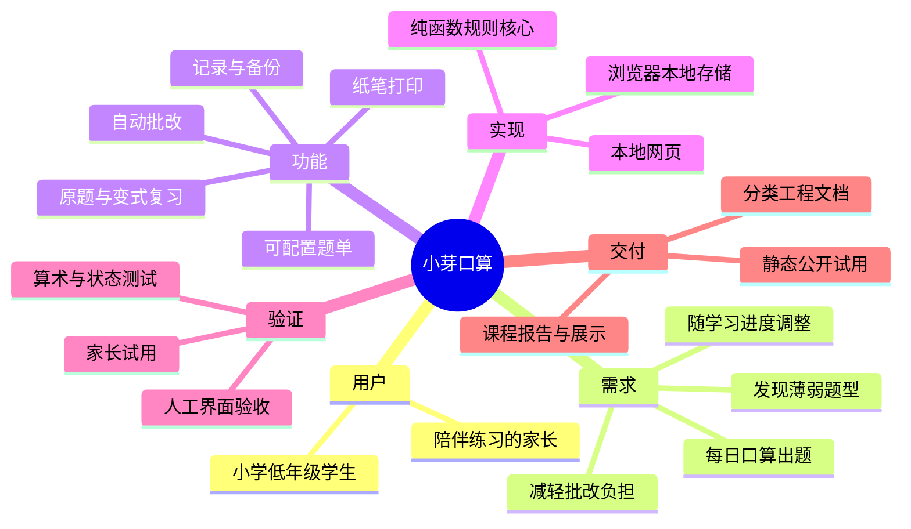

# 软件工程过程记录

## 当前已发生的工作

- 根据提供的课程教案、报告规范和用户偏好选择第 2 题作为候选实现。
- 建立 `savior/` 的应用、测试、脚本及分类 Markdown 文档。
- 使用 AI 辅助形成需求基线、架构、实现和自动化测试；代码与文档仍需真实成员审阅和理解。
- 用户明确要求不使用 Computer Use 测试，后续界面验收由用户按清单手动执行。
- 用户报告试用了本地 30 题流程，提出可见计时、时间与准确率判断及键盘提示；ver1.0 已实现并添加核心测试。此反馈属于当前用户试用，不冒充目标家长/儿童的正式调研。
- 未举行真实小组会议，未完成家长访谈、教师批准、公开发布或真实用户反馈。

以上只是当前候选工作记录，不代表已经完成团队课程全过程。Markdown 便于版本管理及后续迁入 Wiki，最终课程报告按教师模板整理。

## 立项思维导图

## 真实会议记录模板

| 项目 | 内容 |
| --- | --- |
| 时间、地点或方式 | 待填写 |
| 参会者和角色 | 待填写 |
| 讨论问题 | 待填写 |
| 候选方案与取舍 | 待填写 |
| 最终决定与依据 | 待填写 |
| 行动项、负责人、截止日期 | 待填写 |
| 经同意保存的会议照片路径 | 待填写 |

## 需求与设计评审模板

记录日期、评审人、涉及需求编号、具体问题、决定、负责人、修订版本、对应测试。重点检查儿童操作习惯、练习范围、纸笔流程、错题规则与存储边界。没有评审证据时不标记为「已通过」。

## AI 辅助开发记录建议

每次保留任务摘要、采用的建议、人工修订、验证结果及局限。重点记录如何发现和解决错误，而非只粘贴生成内容。当前采用 AI 生成的候选材料尚不能替代学生个人理解、真实调研或个人报告。

## 课程交付核对

| 要求 | 当前材料 | 尚需完成 |
| --- | --- | --- |
| 头脑风暴、会议记录、照片 | 模板和思维导图 | 真实小组讨论和证据 |
| NABCD | requirements/nabcd.md | 结合调研修订 |
| 原型截图与访问地址 | 可交互应用、prototype.md | 手动截图、发布地址 |
| 不少于30项任务与甘特图 | plan.md，36项 | 实际人员和日期 |
| 架构、数据结构、算法 | architecture.md | 成员评审与设计报告 |
| 代码管理过程 | 当前本地候选文件 | 小组真实提交记录，Gitee要求确认 |
| 测试计划、用例与结果 | testing/ | 人工测试记录和截图 |
| 可执行软件与用户说明 | index.html、release/user-guide.md | 跨设备验收 |
| 网页介绍和获取方式 | 应用介绍、发布指南 | 公开地址、截图、至少保留1个月 |
| 用户反馈 | research.md 模板 | 实际试用证据 |
| 每人分工与体会 | 报告提纲 | 各组员独立撰写真实经历 |

注意：教案说明个人需求/设计报告合计 30%、小组提交 70%；项目质量指标另有 20/35/30/10/5 的分项权重。不要将它们误写成同一层级的比例。
